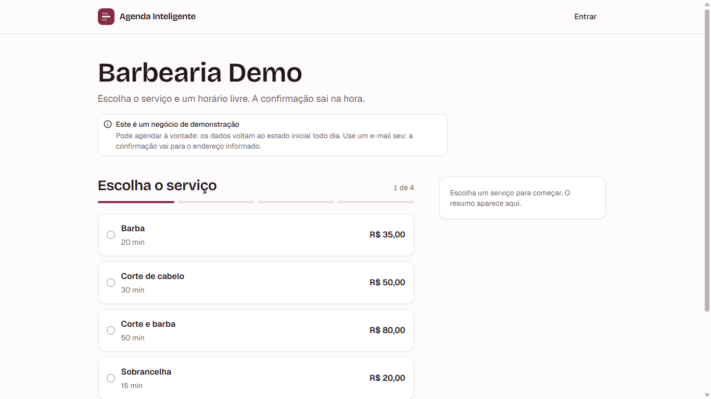
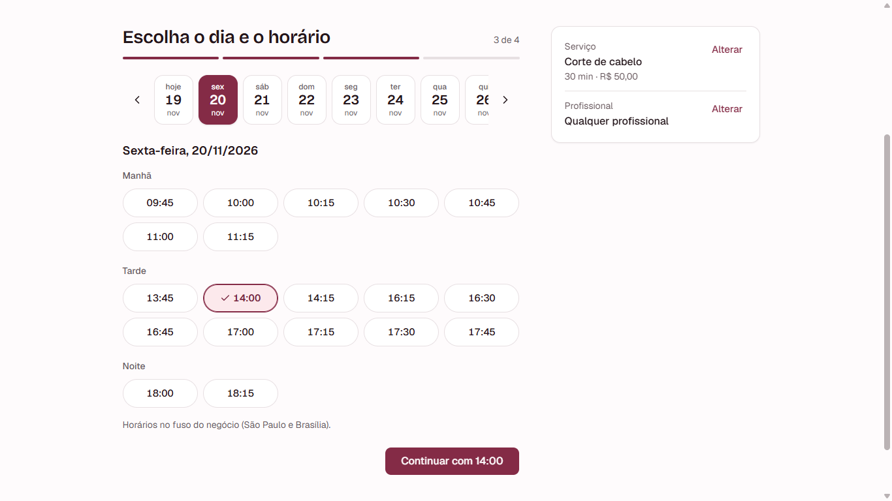
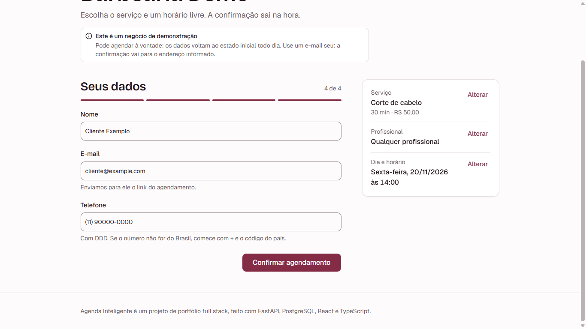
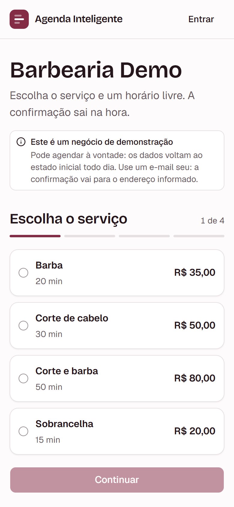
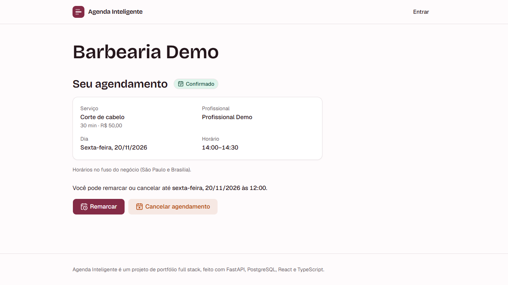
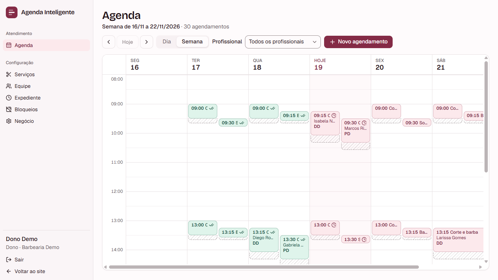
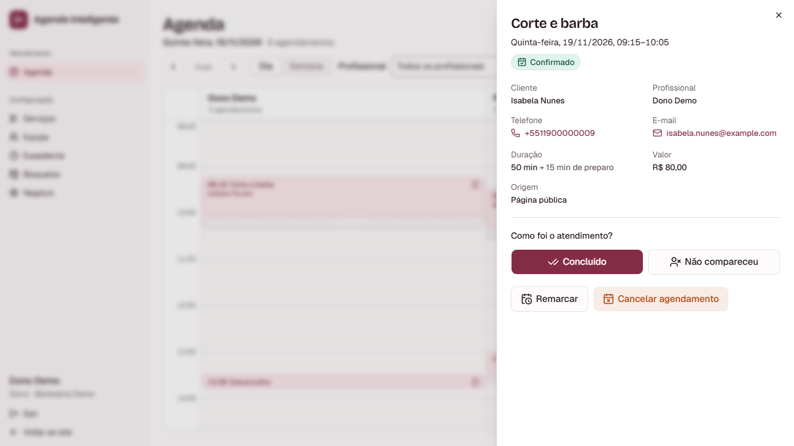
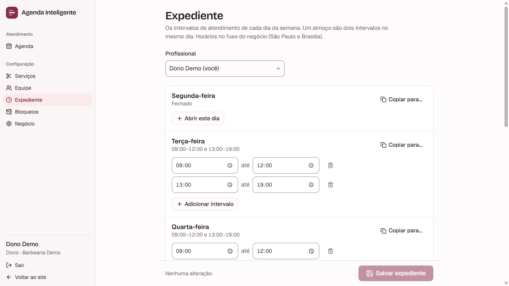
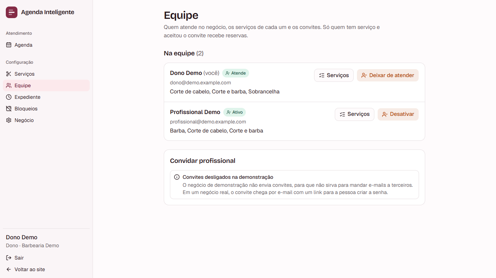
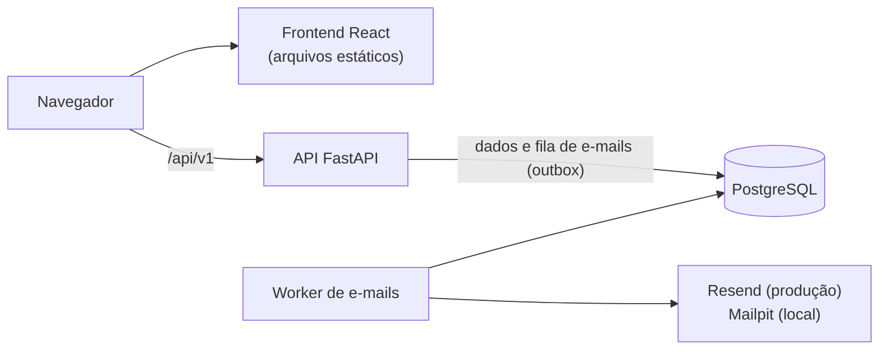

# Agenda Inteligente

Agendamento online para barbearias, salões e estúdios: o cliente reserva um horário realmente livre em poucos passos, sem criar conta, e a equipe gerencia a agenda, o expediente e a configuração do negócio.

[](https://github.com/kaikyjefferson0/agenda-inteligente/actions/workflows/ci.yml)

## Demonstração online

| O quê | Endereço |
|---|---|
| Aplicação | <https://agenda.kaikyjefferson.dev> |
| Página pública da demo | <https://agenda.kaikyjefferson.dev/n/barbearia-demo> |
| Documentação da API (Swagger) | <https://api-agenda.kaikyjefferson.dev/docs> |

A demo é uma barbearia fictícia, e os dados dela voltam ao estado inicial todo dia.

- **Como cliente:** abra a página da demo, escolha o serviço, o profissional (ou "Qualquer profissional"), o dia e o horário, e informe nome, e-mail e telefone. A confirmação sai na hora, com o link para consultar, cancelar ou remarcar. O link também vai para o e-mail informado, então use um endereço seu.
- **Como equipe:** em <https://agenda.kaikyjefferson.dev/entrar>, use o atalho "Conhecer pela demonstração" para entrar como Dono ou como Profissional, sem digitar senha.

A API roda no plano gratuito do Render e dorme depois de 15 minutos sem uso, então o primeiro acesso pode levar alguns segundos.

## Telas

**Página pública do negócio:** o cliente escolhe o serviço, com duração e preço.



**Escolha do dia e do horário:** só aparecem horários livres, no fuso do negócio.



**Dados do cliente:** último passo antes de confirmar, com o resumo ao lado.



**Celular:** a mesma página pública em 390 px.



**Link do cliente:** consulta do agendamento, com remarcação e cancelamento dentro do prazo.



**Agenda da equipe:** visão semanal em grade, com o preparo hachurado e a linha de "agora".



**Detalhe do agendamento:** dados do cliente, resultado do atendimento, remarcação e cancelamento.



**Expediente:** intervalos de cada dia da semana; um almoço são dois intervalos.



**Equipe:** quem atende, os serviços de cada um, desativação e convites.



As telas internas foram capturadas num ambiente local com os dados fictícios da demo.

## Funcionalidades

**Cliente (sem conta)**

- Página pública por negócio (`/n/:slug`), em quatro passos: serviço, profissional, dia e horário, dados.
- Horários calculados a partir do expediente, da duração mais o preparo, dos bloqueios, dos agendamentos e da antecedência mínima e máxima do negócio.
- "Qualquer profissional": o sistema atribui o profissional apto e livre com menos agendamentos no dia.
- Link seguro do agendamento, na tela e por e-mail, para consultar, cancelar ou remarcar dentro do prazo definido pelo negócio.

**Negócio e equipe**

- Login com sessão renovada de forma segura entre abas, recuperação de senha e convite de profissionais.
- Agenda por dia ou semana, em grade por profissional, com agendamento manual, remarcação, cancelamento e registro de "concluído" ou "não compareceu".
- Expediente semanal e bloqueios (folgas e exceções).
- Configuração do Dono: serviços, equipe, serviços de cada profissional e dados do negócio (fuso, passo da grade, antecedência e prazo de alteração).
- Dois papéis: o Dono vê e gerencia tudo; o Profissional, só a própria agenda, expediente e bloqueios.
- E-mails de confirmação, cancelamento e remarcação, com limites de envio.

## Tecnologias

| Camada | Tecnologias |
|---|---|
| Backend | Python 3.14, FastAPI, SQLAlchemy 2 (assíncrono, asyncpg), Alembic, Pydantic v2, PyJWT, Argon2, uv |
| Frontend | React 19, TypeScript, Vite, Tailwind CSS 4, shadcn/ui (Radix), React Router, TanStack Query, React Hook Form, Zod, openapi-fetch e openapi-typescript |
| Banco | PostgreSQL 18 |
| Testes e qualidade | pytest, pytest-cov, Ruff, mypy (strict), Vitest, Testing Library, MSW, Playwright, ESLint |
| Infraestrutura | Docker Compose, Mailpit (e-mail local), GitHub Actions |
| Produção | Render, Neon, Resend, Cloudflare (domínio e DNS) |

## Arquitetura

É um monorepo com uma API FastAPI e uma SPA React. O backend segue as camadas `api → services → repositories`, com as regras de agendamento isoladas em `domain/`, como funções puras. O frontend é organizado por funcionalidade, e cada grupo de rotas (público, conta e painel) é carregado sob demanda.

```text
backend/app/
├── api/           # Rotas, dependências e tradução de erros para HTTP
├── services/      # Casos de uso e controle da transação
├── domain/        # Regras puras: disponibilidade, prazos, atribuição
├── repositories/  # Consultas, sempre com business_id
├── models/        # Modelos SQLAlchemy
├── schemas/       # Modelos Pydantic
├── core/          # Configuração, banco, segurança e logs
├── email/         # Interface de envio, adaptadores (SMTP, Resend, falso) e textos
└── jobs/          # Worker de e-mails, limpeza e restauração da demo

frontend/src/
├── api/           # Cliente tipado, gerado do OpenAPI da API
├── app/           # Roteador e provedores
├── components/    # shadcn/ui, layouts e feedback
├── features/      # booking, customer-appointment, auth, team-agenda,
│                  # work-schedule, services, team, business-settings
├── hooks/
├── lib/           # Funções puras: datas e fusos, formatação
└── pages/         # public/, account/ e panel/
```

Como as partes se conectam:



O navegador carrega a SPA e chama a API. A API grava o agendamento e o e-mail a enviar na mesma transação. O worker lê a fila no PostgreSQL e envia pelo Resend em produção ou pelo Mailpit localmente. Em produção, o worker e a restauração diária da demo rodam dentro do processo da API. O detalhe está em [`docs/08-arquitetura.md`](docs/08-arquitetura.md).

## Decisões técnicas

- **Regras puras em `domain/`, com o tempo injetado.** A disponibilidade, os prazos e a atribuição recebem o instante atual como parâmetro e não acessam o banco. Assim, fusos, horário de verão e prazos são testados de forma determinística (100% de cobertura medida em `app/domain`).
- **Nenhum conflito garantido pelo banco.** Restrições `EXCLUDE` do PostgreSQL e o travamento dos profissionais em ordem de id, na mesma transação, impedem dois agendamentos sobrepostos mesmo com requisições simultâneas. Um teste de concorrência confere que só uma de duas reservas no mesmo horário é aceita.
- **Isolamento entre negócios.** O negócio vem sempre da sessão, os repositórios exigem `business_id`, e chaves estrangeiras compostas impedem relações entre negócios. Um recurso de outro negócio responde `404`, sem revelar que existe; um do mesmo negócio sem permissão responde `403`.
- **E-mails pelo padrão outbox.** O e-mail é gravado na mesma transação da operação, e o worker o envia depois, com `FOR UPDATE SKIP LOCKED` e novas tentativas. Uma falha no provedor nunca desfaz o agendamento, e nada é enviado por uma operação desfeita, sem precisar de Redis ou fila externa.
- **Frontend tipado a partir do OpenAPI.** O `openapi.json` exportado da API gera os tipos do cliente (`schema.d.ts`). O CI falha se algum dos dois estiver desatualizado, então uma mudança de contrato não passa sem o frontend acompanhar.
- **Cobertura mínima e deploy só depois do CI.** O CI bloqueia o merge abaixo de 80% de cobertura no backend, 90% em `app/domain` e 80% nas pastas do frontend, e o Render só publica um commit da `main` depois de o CI passar (`autoDeployTrigger: checksPass`).

## Como rodar localmente

**Pré-requisitos:** Docker com Docker Compose. Para rodar comandos fora dos containers, também [uv](https://docs.astral.sh/uv/) e Node 24.

```bash
# 1. Variáveis de ambiente (valores só para desenvolvimento)
cp .env.example .env

# 2. Subir banco, API, worker, Mailpit e frontend
docker compose up --build

# 3. Em outro terminal: aplicar as migrações
docker compose exec api alembic upgrade head

# 4. Criar o negócio de demonstração, com dados fictícios
docker compose run --rm api python -m app.jobs.restore_demo
```

No Windows (`cmd`), troque o `cp` por `copy`.

| Serviço | Endereço |
|---|---|
| Frontend | <http://localhost:5174> |
| Página pública da demo | <http://localhost:5174/n/barbearia-demo> |
| API | <http://localhost:8002> |
| Documentação da API | <http://localhost:8002/docs> |
| E-mails enviados (Mailpit) | <http://localhost:8025> |
| PostgreSQL | `localhost:5433` |

Para entrar no painel local, use o atalho "Conhecer pela demonstração" em <http://localhost:5174/entrar>. As contas da demo são `dono@demo.example.com` e `profissional@demo.example.com`, com a senha definida em `DEMO_PASSWORD` no `.env`.

O código é montado nos containers e recarrega sozinho. O worker não recarrega: depois de mudar o backend, rode `docker compose restart worker`.

## Testes e qualidade

Números medidos em 19/11/2026:

| Parte | Testes | Cobertura medida | Mínimo exigido no CI |
|---|---|---|---|
| Backend (pytest) | 1246 | 98,66% no geral | 80% |
| Regras de domínio (`app/domain`) | (incluídos acima) | 100% | 90% |
| Frontend (Vitest) | 524, em 39 arquivos | 94,46% das instruções e 95,81% das linhas | 80% em `src/lib`, `src/api` e cada pasta de `src/features` |

Os testes do backend usam PostgreSQL real, porque a garantia de nenhum conflito depende dele.

```bash
# Backend (com os containers no ar)
docker compose exec api ruff check .
docker compose exec api ruff format --check .
docker compose exec api mypy
docker compose exec api pytest --cov --cov-report=term-missing --cov-fail-under=80
docker compose exec api coverage report --include="app/domain/*" --fail-under=90

# Frontend
docker compose exec frontend npm run lint
docker compose exec frontend npm run typecheck
docker compose exec frontend npm run test:coverage
docker compose exec frontend npm run build

# Ponta a ponta (Playwright), na pasta frontend, fora do container
npx playwright install chromium   # uma vez
npm run test:e2e
```

O `npm run test:e2e` sobe o sistema completo do `docker-compose.e2e.yml`, com o build de produção do frontend (porta 5175), a API (porta 8003) e um banco próprio recriado a cada execução. Ele não toca no ambiente de desenvolvimento. Os fluxos são o agendamento e o cancelamento pelo cliente (E2E01) e a entrada da equipe na agenda (E2E02), em desktop e celular.

O [CI](.github/workflows/ci.yml) roda em todo pull request e em todo push na `main`:

1. **Backend:** Ruff (lint e formatação) e mypy strict.
2. **Testes do backend:** migrações aplicadas do zero, `alembic check`, pytest com cobertura mínima de 80% no geral e de 90% em `app/domain`, e conferência do `openapi.json` do frontend.
3. **Frontend:** ESLint, `tsc`, conferência da CSP do `render.yaml`, Vitest com cobertura mínima, conferência do `schema.d.ts` e build.
4. **Ponta a ponta:** Playwright no Chromium. Um teste instável, que só passa na repetição, falha o job.
5. **Imagens Docker:** build das imagens do backend e do frontend.

## Deploy

| Peça | Onde |
|---|---|
| Site (`agenda.kaikyjefferson.dev`) | Render, Static Site |
| API (`api-agenda.kaikyjefferson.dev`) | Render, Web Service gratuito; envia os e-mails e restaura a demo no próprio processo |
| Banco | Neon (PostgreSQL) |
| E-mails | Resend, com o domínio `mail.kaikyjefferson.dev` |
| Domínio e DNS | Cloudflare |

Os dois serviços estão descritos no [`render.yaml`](render.yaml), um Blueprint do Render sem segredos. Cada commit na `main` só é publicado depois de o CI passar, e as migrações rodam antes de a API subir. Site e API ficam em subdomínios do mesmo domínio para que o cookie de sessão (`SameSite=Strict`) funcione. O passo a passo, as variáveis e o teste de fumaça estão no [guia de deploy](docs/deploy.md).

## Documentação

| Documento | Conteúdo |
|---|---|
| [Índice e pontos a revisar](docs/README.md) | Visão geral da documentação e registro de decisões |
| [Visão do produto](docs/01-visao-produto.md) | Problema, público, escopo da V1 e critérios de sucesso |
| [Perfis de usuário](docs/02-perfis-usuario.md) | Perfis e matriz de permissões |
| [Regras de negócio](docs/03-regras-negocio.md) | RN01 a RN31 |
| [Casos de uso](docs/04-casos-de-uso.md) | UC01 a UC18 |
| [Casos de teste](docs/05-casos-de-teste.md) | Estratégia, casos de teste e rastreabilidade |
| [Modelo de dados](docs/06-modelo-dados.md) | Tabelas, restrições e garantia de nenhum conflito |
| [API](docs/07-api.md) | Rotas, convenções e códigos de erro |
| [Arquitetura](docs/08-arquitetura.md) | Componentes, fluxos críticos, segurança, CI e produção |
| [Frontend](docs/09-frontend.md) | Estrutura, rotas, sessão, identidade visual e testes |
| [Guia de deploy](docs/deploy.md) | Render, Neon, Resend e Cloudflare, passo a passo |

## Próximos passos

Pendências registradas em [`docs/README.md`](docs/README.md#pontos-a-revisar):

- **Tela de cadastro de negócio:** a rota `POST /auth/register` existe e é testada, mas o frontend ainda não tem a tela (sugestão: `/cadastro`, sem link visível enquanto o cadastro estiver desligado).
- **Login da demonstração pela API:** uma rota `POST /auth/demo` tiraria a senha da demo do JavaScript público e permitiria trocá-la sem novo build.
- **Alterações não salvas em gavetas e formulários curtos:** hoje, fechar a gaveta da agenda ou recolher um formulário na própria página descarta o que foi digitado, sem perguntar.

## Autor

Projeto individual, do produto à infraestrutura, feito por **Kaiky Jefferson**.

- GitHub: [github.com/kaikyjefferson0](https://github.com/kaikyjefferson0)
- LinkedIn: [linkedin.com/in/kaikyjefferson](https://www.linkedin.com/in/kaikyjefferson)
