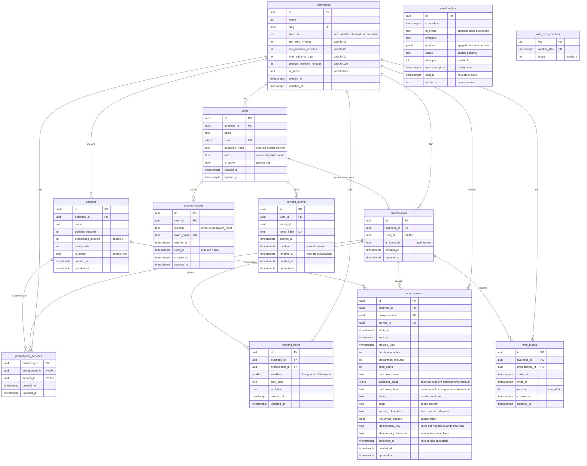

# 6. Modelo de dados

Banco: PostgreSQL, com as extensões `citext` e `btree_gist`. As migrações são feitas com Alembic.

São 12 tabelas: 10 de domínio, que aparecem ligadas no diagrama, e 2 de infraestrutura, `email_outbox` e `rate_limit_counters`, que não têm chaves estrangeiras.

## Convenções

- Chaves primárias são UUID, geradas no banco com `gen_random_uuid()`. As exceções são `professional_services` e `rate_limit_counters`, que têm chaves compostas.
- Toda tabela de domínio tem `created_at` e `updated_at`, `NOT NULL` e com padrão `now()`. `updated_at` é atualizado pelo ORM, sem trigger, então um `UPDATE` em SQL puro precisa atualizar a coluna.
- Instantes usam `timestamptz` e são tratados em UTC. O expediente usa `time`, em hora local do negócio.
- Preços ficam em centavos (`price_cents`), somente em BRL.
- Nomes de tabelas, colunas e valores ficam em inglês, como no código.
- Tokens são guardados somente como hash. A única exceção é `email_outbox.payload`, que guarda o link com token bruto até o envio.
- Toda coluna é `NOT NULL`, salvo as indicadas como nuláveis em cada tabela.
- Toda chave estrangeira usa `ON DELETE RESTRICT`. Nada é apagado em cascata, e quem apaga dados remove os dependentes antes. É o caso da [restauração da demo](03-regras-negocio.md#contas-e-demo).
- Restrições seguem os prefixos `pk_`, `uq_`, `fk_<tabela>_<referenciada>`, `ck_<tabela>_` e `ix_`. As restrições `EXCLUDE` usam o sufixo `_no_overlap`.

## Enums

Os enums são colunas `text` com uma restrição `CHECK` e um `StrEnum` no código. Tipos nativos do PostgreSQL não são usados, porque acrescentar um valor exige apenas trocar o `CHECK`.

| Coluna | Enum no código | Valores | Padrão |
|---|---|---|---|
| `users.role` | `UserRole` | `owner`, `professional` | Nenhum |
| `account_tokens.purpose` | `AccountTokenPurpose` | `invite`, `password_reset` | Nenhum |
| `appointments.status` | `AppointmentStatus` | `confirmed`, `cancelled`, `completed`, `no_show` | `confirmed` |
| `appointments.origin` | `AppointmentOrigin` | `public`, `staff` | Nenhum |
| `email_outbox.status` | `EmailOutboxStatus` | `pending`, `sent`, `failed` | `pending` |

## Diagrama



## Tabelas

### `businesses`

Configurações de cada negócio. `slug` é único, sem diferenciar maiúsculas. `timezone` não tem padrão e é informado no cadastro. `is_demo` identifica o negócio de demonstração.

- **Padrões:** passo de 15, antecedência mínima de 60 minutos, máxima de 30 dias, prazo de alteração de 120 minutos e `is_demo = false`.
- **`CHECK`:** `slot_step_minutes IN (5, 10, 15, 20, 30, 60)`, `min_advance_minutes >= 0`, `max_advance_days > 0` e `change_deadline_minutes >= 0`.

### `users`

Contas de Dono e Profissional. O e-mail é único em todo o sistema, sem diferenciar maiúsculas, porque cada conta pertence a um único negócio.

- **Nulável:** `password_hash`, até o convite ser aceito.
- **Padrão:** `is_active = true`.
- **`UNIQUE`:** `email` e `(business_id, id)`.

### `professionals`

Quem atende clientes, em relação 1:1 com `users`. Separa login de agenda: um Dono que não atende não tem registro aqui. `is_bookable` controla a participação em novas reservas e tem padrão `true`. O registro de um convidado nasce no convite, com `is_bookable = false`, e passa a `true` no aceite. Assim, o Dono já pode configurá-lo, mas ninguém reserva com quem ainda não aceitou. O convite pendente é identificado por `users.password_hash` nulo.

- **`UNIQUE`:** `user_id` e `(business_id, id)`.

### `account_tokens`

Links de uso único para convite e recuperação de senha.

- **Nulável:** `used_at`.
- **`UNIQUE`:** `token_hash`.

### `refresh_tokens`

Sessões, com rotação. Cada refresh usado é substituído por outro da mesma `family_id`. Se um token já usado reaparecer, toda a família é revogada.

O menor `created_at` da família marca o login e define o limite absoluto de 30 dias ([RN31](03-regras-negocio.md#contas-e-demo)). Por isso, uma futura limpeza deve apagar famílias inteiras, nunca linhas soltas.

- **Nuláveis:** `used_at` e `revoked_at`.
- **`UNIQUE`:** `token_hash`.

### `services`

Serviços com duração, preparo e preço. São desativados com `is_active = false`, porque agendamentos os referenciam.

- **Padrões:** `preparation_minutes = 0` e `is_active = true`.
- **`UNIQUE`:** `(business_id, id)`.
- **`CHECK`:** `duration_minutes > 0`, `preparation_minutes >= 0` e `price_cents >= 0`.

### `professional_services`

Serviços atendidos por cada profissional. A chave primária é `(professional_id, service_id)`.

### `working_hours`

Expediente semanal em hora local, com vários intervalos por dia para representar o almoço. A não sobreposição é validada na aplicação, sob o travamento do profissional.

- **`CHECK`:** `end_time > start_time`, portanto não há expediente que atravesse a meia-noite, e `weekday BETWEEN 0 AND 6`.

### `time_blocks`

Exceções à agenda, como folgas. `reason` é obrigatório.

- **`CHECK`:** `ends_at > starts_at`.
- **`EXCLUDE`:** `time_blocks_no_overlap`, descrita em [Garantia de nenhum conflito](#garantia-de-nenhum-conflito).

### `appointments`

- `ends_at` é o fim do atendimento, e `blocked_until` inclui o preparo.
- `duration_minutes`, `preparation_minutes` e `price_cents` são cópias do momento da reserva.
- Os dados do cliente ficam na própria linha. Não há tabela `customers`, porque o e-mail não é verificado.
- `status` nasce como `confirmed`.
- `access_token_hash` é único quando não nulo. Fica nulo somente em agendamento manual sem e-mail.
- `idempotency_key` é única por negócio quando não nula. `idempotency_fingerprint` é o hash dos dados enviados, usado para detectar reuso da chave com dados diferentes.
- `link_email_skipped` tem padrão `false` e fica `true` quando o limite de e-mail impede o envio na criação. Nesse caso, uma repetição idempotente substitui `access_token_hash`, conforme a RN13.
- O histórico se limita a `created_at`, `updated_at` e `cancelled_at`. Não há tabela de eventos na V1.

**Nuláveis:** `customer_email`, `customer_phone`, `access_token_hash`, `idempotency_key`, `idempotency_fingerprint` e `cancelled_at`.

| `CHECK` | Regra |
|---|---|
| `ends_at > starts_at AND blocked_until >= ends_at` | Ordem dos instantes |
| `duration_minutes > 0`, `preparation_minutes >= 0`, `price_cents >= 0` | Valores copiados válidos |
| `origin <> 'public' OR (customer_email IS NOT NULL AND customer_phone IS NOT NULL)` | Agendamento público exige contato |
| `access_token_hash IS NOT NULL OR (origin = 'staff' AND customer_email IS NULL)` | Só agendamento manual sem e-mail dispensa o token (RN16) |
| `(idempotency_key IS NULL) = (idempotency_fingerprint IS NULL)` | Chave e fingerprint andam juntos |

### `email_outbox`

Fila de e-mails gravada na mesma transação da operação de negócio. Como é infraestrutura, tem `created_at`, mas não `updated_at`.

| Coluna | Tipo | Nula | Padrão | Descrição |
|---|---|---|---|---|
| `id` | `uuid` | Não | `gen_random_uuid()` | Identificação |
| `created_at` | `timestamptz` | Não | `now()` | Criação |
| `to_email` | `text` | Sim | | Destinatário |
| `template` | `text` | Não | | Modelo |
| `payload` | `jsonb` | Sim | | Dados do modelo, incluindo o link com token bruto |
| `status` | `text` | Não | `pending` | `pending`, `sent` ou `failed` |
| `attempts` | `int` | Não | `0` | Tentativas feitas |
| `next_attempt_at` | `timestamptz` | Não | `now()` | Próxima tentativa |
| `sent_at` | `timestamptz` | Sim | | Momento do envio |
| `last_error` | `text` | Sim | | Último erro |

Como `payload` pode conter um token bruto até o envio, ele é **apagado** quando a mensagem chega a `sent` ou `failed`. O mesmo vale para `to_email`, depois de um período curto de retenção. "Apagado" significa `NULL` do SQL, não o valor `null` do JSON.

**`CHECK`:**

- `attempts >= 0`.
- `status <> 'pending' OR (to_email IS NOT NULL AND payload IS NOT NULL)`: mensagem pendente tem destinatário e dados.
- `status = 'pending' OR payload IS NULL`: o `payload` precisa ser apagado na mesma escrita que muda o status.

### `rate_limit_counters`

Contadores por janela. Chave primária `(key, window_start)`, com `count`, de padrão 0. `key` é `text` e não contém IP nem e-mail em claro; usa um HMAC desses valores. `window_start` é `timestamptz`. Não há `id` nem colunas de auditoria. Janelas vencidas são removidas periodicamente.

## Isolamento entre negócios

`users`, `professionals` e `services` têm `UNIQUE (business_id, id)`. As tabelas dependentes usam chaves estrangeiras compostas, além da chave simples de `business_id` para `businesses`:

- `appointments (business_id, professional_id)` referencia `professionals (business_id, id)`.
- `appointments (business_id, service_id)` referencia `services (business_id, id)`.
- `professional_services (business_id, professional_id)` referencia `professionals (business_id, id)`.
- `professional_services (business_id, service_id)` referencia `services (business_id, id)`.
- `working_hours (business_id, professional_id)` referencia `professionals (business_id, id)`.
- `time_blocks (business_id, professional_id)` referencia `professionals (business_id, id)`.
- `professionals (business_id, user_id)` referencia `users (business_id, id)`.

Assim, um bug na aplicação não consegue ligar registros de negócios diferentes. A leitura é protegida pelo filtro obrigatório de `business_id` nos repositórios.

`account_tokens` e `refresh_tokens` não têm `business_id` e referenciam `users (id)` diretamente.

## Garantia de nenhum conflito

### Agendamento com agendamento

```sql
CREATE EXTENSION IF NOT EXISTS btree_gist;

ALTER TABLE appointments
  ADD CONSTRAINT appointments_no_overlap
  EXCLUDE USING gist (
    professional_id WITH =,
    tstzrange(starts_at, blocked_until, '[)') WITH &&
  )
  WHERE (status <> 'cancelled');
```

`completed` e `no_show` continuam ocupando o tempo, então somente `cancelled` fica de fora. Uma violação (`23P01`) é convertida em `409 SLOT_UNAVAILABLE`.

### Bloqueio com bloqueio

```sql
ALTER TABLE time_blocks
  ADD CONSTRAINT time_blocks_no_overlap
  EXCLUDE USING gist (
    professional_id WITH =,
    tstzrange(starts_at, ends_at, '[)') WITH &&
  );
```

### Agendamento com bloqueio

A restrição `EXCLUDE` não alcança duas tabelas. Por isso, **toda escrita em `appointments`, `time_blocks` e `working_hours` trava antes as linhas envolvidas de `professionals`** com `SELECT ... FOR UPDATE`, dentro da mesma transação, e só depois verifica os conflitos.

Em "sem preferência" e em remarcações entre profissionais, os candidatos são travados em ordem de `id`, para evitar deadlocks.

## Índices

Além dos índices criados pelas chaves primárias e pelas restrições `UNIQUE`:

| Tabela | Índice | Uso |
|---|---|---|
| `appointments` | `(business_id, professional_id, starts_at)` | Agenda e disponibilidade |
| `appointments` | `(business_id, starts_at)` | Agenda de todos os profissionais |
| `appointments` | `UNIQUE (access_token_hash)` onde não nulo | Acesso pelo link |
| `appointments` | `UNIQUE (business_id, idempotency_key)` onde não nula | Idempotência |
| `time_blocks` | Índice da restrição `EXCLUDE` | Disponibilidade |
| `working_hours` | `(professional_id, weekday)` | Disponibilidade |
| `professional_services` | `(service_id)` | Profissionais que atendem um serviço (RN10) |
| `email_outbox` | `(next_attempt_at)` onde `status = 'pending'` | Worker |
| `refresh_tokens` | `(family_id)` | Revogação da família |
| `refresh_tokens` | `(user_id)` | Revogação das sessões ao trocar a senha (UC03) |
| `account_tokens` | `(user_id)` | Tokens de um usuário |
