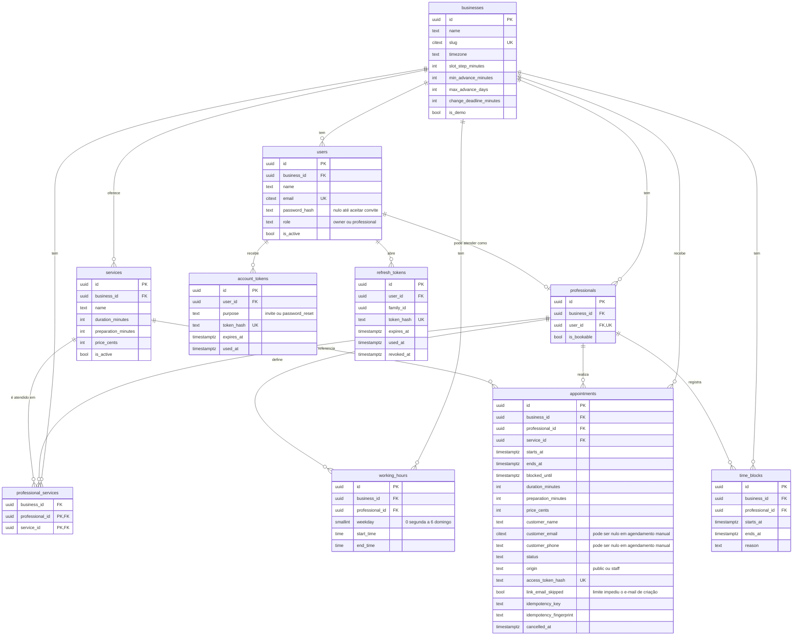

# 6. Modelo de dados

Banco: PostgreSQL. As migrações são feitas com Alembic.

## Convenções

- Chaves primárias são UUID.
- Toda tabela de domínio tem `created_at` e `updated_at`.
- Instantes usam `timestamptz` e são tratados em UTC. O expediente usa `time`, em hora local do negócio.
- Preços ficam em centavos (`price_cents`), somente em BRL.
- Nomes de tabelas, colunas e valores ficam em inglês, como no código.
- Tokens são guardados somente como hash.

## Diagrama



As tabelas de infraestrutura `email_outbox` e `rate_limit_counters` são independentes e estão descritas abaixo.

## Tabelas

### `businesses`

Configurações de cada negócio. `slug` é único, sem diferenciar maiúsculas. `slot_step_minutes` aceita 5, 10, 15, 20, 30 ou 60. Os padrões são: passo de 15, antecedência mínima de 60 minutos, máxima de 30 dias e prazo de alteração de 120 minutos. `is_demo` identifica o negócio de demonstração.

### `users`

Contas de Dono e Profissional. O e-mail é único em todo o sistema, porque cada conta pertence a um único negócio. `password_hash` fica nulo até o convite ser aceito.

### `professionals`

Quem atende clientes, em relação 1:1 com `users`. Separa login de agenda: um Dono que não atende não tem registro aqui. `is_bookable` controla a participação em novas reservas.

### `account_tokens`

Links de uso único para convite e recuperação de senha.

### `refresh_tokens`

Sessões, com rotação. Cada refresh usado é substituído por outro da mesma `family_id`. Se um token já usado reaparecer, toda a família é revogada.

### `services`

Serviços com duração, preparo (padrão 0) e preço. São desativados com `is_active = false`, porque agendamentos os referenciam.

### `professional_services`

Serviços atendidos por cada profissional. A chave primária é `(professional_id, service_id)`.

### `working_hours`

Expediente semanal em hora local, com vários intervalos por dia para representar o almoço. `CHECK (end_time > start_time)`, portanto não há expediente que atravesse a meia-noite. A não sobreposição é validada na aplicação, sob o travamento do profissional.

### `time_blocks`

Exceções à agenda, como folgas. `CHECK (ends_at > starts_at)` e restrição `EXCLUDE` contra sobreposição no mesmo profissional.

### `appointments`

- `ends_at` é o fim do atendimento, e `blocked_until` inclui o preparo. `CHECK (ends_at > starts_at AND blocked_until >= ends_at)`.
- `duration_minutes`, `preparation_minutes` e `price_cents` são cópias do momento da reserva.
- Os dados do cliente ficam na própria linha. Não há tabela `customers`, porque o e-mail não é verificado.
- `status` aceita `confirmed`, `cancelled`, `completed` e `no_show`.
- `CHECK`: agendamentos com `origin = 'public'` exigem `customer_email` e `customer_phone`.
- `access_token_hash` é único quando não nulo. Fica nulo em agendamento manual sem e-mail.
- `idempotency_key` é única por negócio quando não nula. `idempotency_fingerprint` é o hash dos dados enviados, usado para detectar reuso da chave com dados diferentes.
- `link_email_skipped` tem padrão `false` e fica `true` quando o limite de e-mail impede o envio na criação. Nesse caso, uma repetição idempotente substitui `access_token_hash`, conforme a RN13.
- O histórico se limita a `created_at`, `updated_at` e `cancelled_at`. Não há tabela de eventos na V1.

### `email_outbox`

Fila de e-mails gravada na mesma transação da operação de negócio.

| Coluna | Descrição |
|---|---|
| `id`, `created_at` | Identificação |
| `to_email`, `template` | Destinatário e modelo |
| `payload` | Dados do modelo, incluindo o link com token bruto |
| `status` | `pending`, `sent` ou `failed` |
| `attempts`, `next_attempt_at` | Controle de retentativas |
| `sent_at`, `last_error` | Resultado do envio |

Como `payload` pode conter um token bruto até o envio, ele é **apagado** quando a mensagem chega a `sent` ou `failed`. O mesmo vale para `to_email`, depois de um período curto de retenção.

### `rate_limit_counters`

Contadores por janela. Chave primária `(key, window_start)`, com `count`. `key` não contém IP nem e-mail em claro; usa um HMAC desses valores. Janelas vencidas são removidas periodicamente.

## Isolamento entre negócios

`users`, `professionals` e `services` têm `UNIQUE (business_id, id)`. As tabelas dependentes usam chaves estrangeiras compostas:

- `appointments (business_id, professional_id)` referencia `professionals (business_id, id)`.
- `appointments (business_id, service_id)` referencia `services (business_id, id)`.
- `professional_services`, `working_hours` e `time_blocks` seguem o mesmo padrão.
- `professionals (business_id, user_id)` referencia `users (business_id, id)`.

Assim, um bug na aplicação não consegue ligar registros de negócios diferentes. A leitura é protegida pelo filtro obrigatório de `business_id` nos repositórios.

## Garantia de nenhum conflito

### Agendamento com agendamento

```sql
CREATE EXTENSION IF NOT EXISTS btree_gist;

ALTER TABLE appointments
  ADD CONSTRAINT appointments_no_overlap
  EXCLUDE USING gist (
    professional_id WITH =,
    tstzrange(starts_at, blocked_until, '[)') WITH &&
  )
  WHERE (status <> 'cancelled');
```

`completed` e `no_show` continuam ocupando o tempo, então somente `cancelled` fica de fora. Uma violação (`23P01`) é convertida em `409 SLOT_UNAVAILABLE`.

### Agendamento com bloqueio

A restrição `EXCLUDE` não alcança duas tabelas. Por isso, **toda escrita em `appointments`, `time_blocks` e `working_hours` trava antes as linhas envolvidas de `professionals`** com `SELECT ... FOR UPDATE`, dentro da mesma transação, e só depois verifica os conflitos.

Em "sem preferência" e em remarcações entre profissionais, os candidatos são travados em ordem de `id`, para evitar deadlocks.

## Índices principais

| Tabela | Índice | Uso |
|---|---|---|
| `appointments` | `(business_id, professional_id, starts_at)` | Agenda e disponibilidade |
| `appointments` | `(business_id, starts_at)` | Agenda de todos os profissionais |
| `appointments` | `UNIQUE (access_token_hash)` parcial | Acesso pelo link |
| `appointments` | `UNIQUE (business_id, idempotency_key)` parcial | Idempotência |
| `time_blocks` | Índice da restrição `EXCLUDE` | Disponibilidade |
| `working_hours` | `(professional_id, weekday)` | Disponibilidade |
| `email_outbox` | `(next_attempt_at)` onde `status = 'pending'` | Worker |
| `refresh_tokens` | `(family_id)` | Revogação da família |
