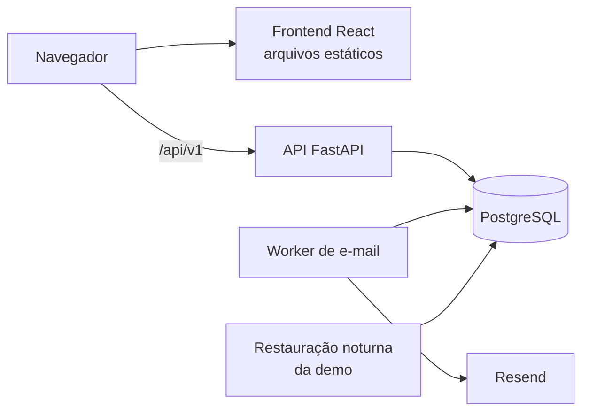
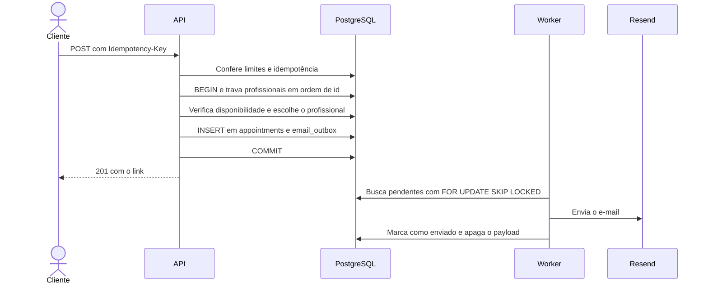

# 8. Arquitetura

## Visão geral



| Componente | Responsabilidade |
|---|---|
| Frontend | SPA com a página pública e o painel da equipe |
| API | Autenticação, regras de negócio e persistência |
| PostgreSQL | Dados, garantias de integridade, fila de e-mails e contadores de limite |
| Worker | Envia os e-mails pendentes, com retentativas |
| Restauração da demo | Tarefa agendada que recria os dados do negócio demo |

## Estrutura do repositório

```text
agenda-inteligente/
├── backend/
│   ├── app/
│   │   ├── api/           # Rotas, dependências e tratamento de erros
│   │   ├── services/      # Casos de uso e transações
│   │   ├── domain/        # Regras puras, como a disponibilidade
│   │   ├── repositories/  # Acesso a dados, sempre com business_id
│   │   ├── models/        # Modelos SQLAlchemy
│   │   ├── schemas/       # Modelos Pydantic
│   │   ├── core/          # Configuração e segurança
│   │   ├── email/         # Interface, adaptadores e modelos
│   │   └── jobs/          # Worker e restauração da demo
│   ├── alembic/
│   └── tests/
├── frontend/
│   ├── src/
│   └── e2e/
├── docs/
├── docker-compose.yml
└── .github/workflows/
```

A documentação é escrita em português, e o código, em inglês.

## Backend

As camadas seguem `api → services → repositories`:

- **`api`** valida a entrada, resolve a sessão e traduz erros para HTTP.
- **`services`** coordena cada caso de uso e controla a transação.
- **`domain`** contém regras puras, sem acesso ao banco e com o tempo recebido como parâmetro.
- **`repositories`** encapsula as consultas e exige `business_id` nas operações de tenant.

**Tecnologias:** FastAPI, SQLAlchemy 2 assíncrono, Alembic, Pydantic v2 e uv. As versões serão fixadas na Fase 1.

### Cálculo de disponibilidade

Uma função pura recebe a configuração, os intervalos de expediente, os períodos ocupados, a duração e o instante atual, e devolve os horários livres. O serviço apenas carrega esses dados do banco e chama a função, o que permite testar todas as regras e mudanças de fuso sem banco.

## Frontend

Vite, React, TypeScript, Tailwind, shadcn/ui, React Router, TanStack Query, React Hook Form e Zod. Os tipos da API são gerados a partir do OpenAPI.

O token de acesso fica somente em memória. Ao recarregar a página, o frontend chama `/auth/refresh`.

## Fluxos críticos

### Criar agendamento



Falhas possíveis:

- **Conflito concorrente:** o travamento e a restrição `EXCLUDE` garantem um único vencedor, e o outro recebe `409`.
- **Corrida de idempotência:** o índice único também trata duas requisições simultâneas com a mesma chave.
- **Provedor fora do ar:** o agendamento já foi confirmado, e o worker tenta de novo mais tarde.

### Envio de e-mails

O padrão outbox grava o e-mail na mesma transação da operação, então nenhum e-mail se perde nem é enviado por uma operação desfeita.

- São até 5 tentativas com espera crescente. Depois disso, a mensagem fica como `failed`, com `last_error`.
- O envio é "pelo menos uma vez". O `id` da mensagem é usado como chave de idempotência, quando o provedor oferece esse recurso.
- `FOR UPDATE SKIP LOCKED` permite vários workers, sem Redis.
- O provedor é o Resend, atrás de uma interface que permite trocá-lo. Os testes usam um adaptador falso.

## Segurança

### Autenticação

- **Senhas:** hash com Argon2id.
- **Token de acesso:** JWT de 15 minutos, mantido em memória.
- **Refresh:** token opaco de 14 dias, com rotação, guardado como hash e entregue em cookie `HttpOnly`, `Secure`, `SameSite=Strict` e `Path=/api/v1/auth`. O reuso revoga a família inteira.
- **Conta desativada:** a dependência de autenticação carrega o usuário a cada requisição e confere `is_active`, então a desativação vale imediatamente.
- **CSRF:** `SameSite=Strict`, cabeçalho `X-Requested-With` nas rotas com cookie e lista fixa de origens em CORS.

### Isolamento entre negócios

1. O negócio vem da sessão, nunca de um parâmetro.
2. Os repositórios exigem `business_id`.
3. As chaves estrangeiras compostas impedem relações entre negócios.
4. O CT19 testa o acesso cruzado em todas as rotas.

RLS não é usado na V1. É uma defesa adicional possível, mas exigiria `SET LOCAL` por transação e exceções para rotas públicas, worker e migrações.

### Proteção contra abuso

Os limites usam contadores no PostgreSQL e valem entre processos. O IP vem apenas do cabeçalho definido pelo proxy confiável da hospedagem. Valores iniciais, a ajustar com o uso:

| Alvo | Limite |
|---|---|
| Criar agendamento público | 10 por hora, por IP |
| Consultar disponibilidade | 120 por minuto, por IP |
| Rotas com token de cliente | 60 por minuto, por IP |
| Login | 10 por 15 minutos, por IP e e-mail |
| Recuperação de senha | 5 por hora, por IP |
| E-mails por destinatário | 3 por dia |
| E-mails no total | 100 por dia, a ajustar conforme o plano do provedor |

O cadastro fechado e as restrições da [RN28](03-regras-negocio.md#contas-e-demo) impedem que a demo envie conteúdo livre a terceiros.

### Dados pessoais

A demo guarda apenas nome, e-mail e telefone do agendamento, e a restauração noturna os apaga. Logs nunca incluem tokens, senhas nem dados de contato. A consulta pelo link não devolve e-mail nem telefone. Esses cuidados não equivalem à operação exigida para clientes reais, que está fora do escopo.

## Ambiente local

O `docker-compose.yml` sobe `db`, `api`, `worker` e `frontend`. Em desenvolvimento, o e-mail usa um adaptador que apenas registra a mensagem no log. Os segredos ficam em variáveis de ambiente, e o repositório inclui somente um `.env.example`.

Variáveis principais:

| Variável | Uso |
|---|---|
| `DATABASE_URL` | Conexão com o banco |
| `JWT_SECRET` | Assinatura do token de acesso |
| `RATE_LIMIT_KEY_SECRET` | HMAC dos contadores de limite |
| `RESEND_API_KEY` | Envio de e-mails |
| `EMAIL_BACKEND` | `console`, `fake` ou `resend` |
| `EMAIL_DAILY_CAP`, `EMAIL_RECIPIENT_DAILY_CAP` | Limites de envio |
| `REGISTRATION_ENABLED` | Liga o cadastro de negócios |
| `CORS_ALLOWED_ORIGINS` | Origens permitidas |

## CI (GitHub Actions)

Em cada pull request:

1. **Backend:** Ruff e mypy.
2. **Testes do backend:** pytest com PostgreSQL e os limites de cobertura de 90% e 80%.
3. **Migrações:** aplica do zero e confere se os modelos estão sincronizados com elas.
4. **Frontend:** ESLint, `tsc` e Vitest.
5. **Ponta a ponta:** Playwright nos fluxos E2E01 e E2E02.
6. **Imagens:** build das imagens Docker.

## Deploy

- **API, worker e banco:** PaaS, como Render ou Railway.
- **Frontend:** hospedagem estática, como Cloudflare Pages ou Vercel.
- **Migrações:** executadas uma vez antes de cada nova versão da API.
- **Restauração da demo:** tarefa agendada da plataforma, que executa `app/jobs`.

A escolha final e os preços serão confirmados antes do deploy, porque os planos gratuitos mudam e podem hibernar serviços ou não oferecer tarefas agendadas.

**Domínio próprio obrigatório:** frontend e API devem ficar em subdomínios do mesmo domínio, como `app.exemplo.com` e `api.exemplo.com`. Domínios padrão de PaaS costumam ser sites diferentes para o navegador, o que impediria o cookie `SameSite=Strict`. O mesmo domínio serve para autenticar o envio de e-mails com SPF e DKIM.

## Registro de decisões

| Tema | Decisão | Motivo principal | Alternativa rejeitada |
|---|---|---|---|
| Modelo | SaaS multi-negócio | Mostra arquitetura com isolamento | Negócio único, marketplace |
| Isolamento | Filtro nos repositórios e chaves compostas | Simples de entender e depurar | RLS, por complexidade |
| Conflitos | `EXCLUDE` e travamento do profissional | Garantia no banco, inclusive entre tabelas | Verificação apenas na aplicação |
| Duplicidade | `Idempotency-Key` | Cobre retentativas de rede e "sem preferência" | Apenas bloquear o botão |
| Cliente | Dados no agendamento | E-mail não verificado não deve associar pessoas | Tabela `customers` |
| Histórico | Apenas campos de data | Nenhum caso de uso consome eventos | Tabela de eventos |
| Quem atende | Tabela `professionals` | Separa login de agenda | Campo em `users` |
| Autenticação | JWT curto e refresh em cookie | Revogável e sem token acessível a scripts | Sessão opaca, `localStorage` |
| E-mail | Outbox e worker próprio | Não perde mensagens e não exige Redis | `BackgroundTasks`, Celery |
| Limites | Contadores no PostgreSQL | Valem entre processos, sem novo serviço | Memória, Redis |
| Demo | Cadastro fechado, e-mail com limites e restauração noturna | Reduz abuso e mantém dados atuais | Cadastro aberto, botão de reset |
| Hospedagem | PaaS e frontend estático | Pouca operação | VPS com Docker Compose |
| Testes | PostgreSQL real e Playwright nos fluxos críticos | Testa as garantias reais com CI rápido | SQLite, E2E em todos os fluxos |
