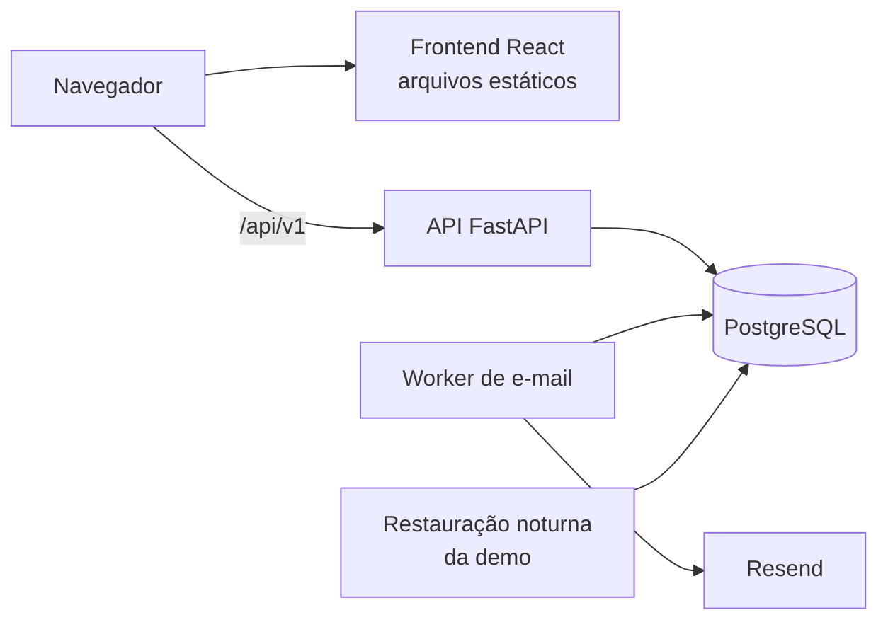
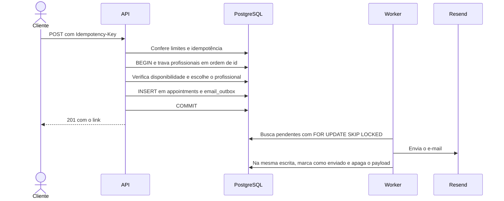
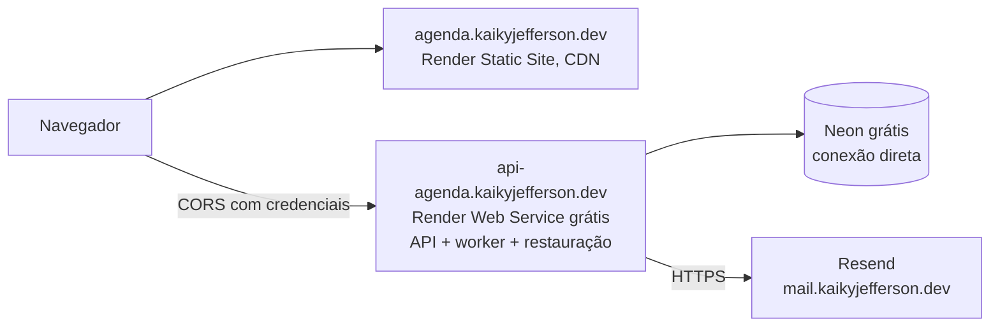

# 8. Arquitetura

## Visão geral



| Componente | Responsabilidade |
|---|---|
| Frontend | SPA com a página pública e o painel da equipe |
| API | Autenticação, regras de negócio e persistência |
| PostgreSQL | Dados, garantias de integridade, fila de e-mails e contadores de limite |
| Worker | Envia os e-mails pendentes, com retentativas. Em produção, roda dentro do processo da API (D105) |
| Restauração da demo | Tarefa que recria os dados do negócio demo em uma única transação, apagando os dependentes antes, porque as chaves estrangeiras usam `ON DELETE RESTRICT`. Em produção, a própria API a dispara uma vez por dia (D106) |

## Estrutura do repositório

```text
agenda-inteligente/
├── backend/
│   ├── app/
│   │   ├── api/           # Rotas, dependências e tratamento de erros
│   │   ├── services/      # Casos de uso e transações
│   │   ├── domain/        # Regras puras, como a disponibilidade
│   │   ├── repositories/  # Acesso a dados, sempre com business_id
│   │   ├── models/        # Modelos SQLAlchemy
│   │   ├── schemas/       # Modelos Pydantic
│   │   ├── core/          # Configuração e segurança
│   │   ├── email/         # Interface, adaptadores e modelos
│   │   └── jobs/          # Worker e restauração da demo
│   ├── alembic/
│   └── tests/
├── frontend/
│   ├── src/
│   └── e2e/
├── docs/
├── docker-compose.yml
└── .github/workflows/
```

A documentação é escrita em português, e o código, em inglês.

## Backend

As camadas seguem `api → services → repositories`:

- **`api`** valida a entrada, resolve a sessão e traduz erros para HTTP.
- **`services`** coordena cada caso de uso e controla a transação.
- **`domain`** contém regras puras, sem acesso ao banco e com o tempo recebido como parâmetro.
- **`repositories`** encapsula as consultas e exige `business_id` nas operações de tenant.

**Tecnologias:** FastAPI, SQLAlchemy 2 assíncrono, Alembic, Pydantic v2 e uv. As versões serão fixadas na Fase 1.

### Cálculo de disponibilidade

Uma função pura recebe a configuração, os intervalos de expediente, os períodos ocupados, a duração e o instante atual, e devolve os horários livres. O serviço apenas carrega esses dados do banco e chama a função, o que permite testar todas as regras e mudanças de fuso sem banco.

## Frontend

Vite, React, TypeScript, Tailwind, shadcn/ui, React Router, TanStack Query, React Hook Form e Zod. Os tipos da API são gerados a partir do OpenAPI. Estrutura, rotas, cliente da API, identidade visual e testes estão em [Frontend](09-frontend.md).

O token de acesso fica somente em memória. Ao recarregar a página, o frontend renova a sessão uma vez, em silêncio, se o `localStorage` indicar que pode haver uma (D71).

**A renovação precisa ser única entre abas.** O refresh tem rotação sem tolerância: duas chamadas simultâneas com o mesmo cookie, como ao recarregar duas abas, são tratadas como reuso e revogam a família, o que encerra a sessão. A fase do frontend deve serializar `/auth/refresh` entre abas, por exemplo com a Web Locks API, e reler o resultado obtido pela aba que renovou. Esse requisito é obrigatório, porque a API não consegue distinguir essa corrida de um roubo de token. O frontend o atende com a Web Locks API e um `BroadcastChannel` (D70), descritos em [Frontend](09-frontend.md#sessão-d70-a-d73).

## Fluxos críticos

### Criar agendamento



Falhas possíveis:

- **Conflito concorrente:** o travamento e a restrição `EXCLUDE` garantem um único vencedor, e o outro recebe `409`.
- **Corrida de idempotência:** o índice único também trata duas requisições simultâneas com a mesma chave.
- **Provedor fora do ar:** o agendamento já foi confirmado, e o worker tenta de novo mais tarde.

### Envio de e-mails

O padrão outbox grava o e-mail na mesma transação da operação, então nenhum e-mail se perde nem é enviado por uma operação desfeita.

- **Reserva (D38):** a cada 5 segundos, o worker seleciona até 20 mensagens `pending` com `next_attempt_at <= agora`, ordenadas por `next_attempt_at`, com `FOR UPDATE SKIP LOCKED`, o que permite vários workers sem Redis. Na mesma transação, soma 1 em `attempts`, adia `next_attempt_at` em 5 minutos e confirma. Só então envia cada mensagem, fora de transação, e grava o resultado em uma transação curta. Um lote cheio é seguido na hora pelo próximo.
- **Pelo menos uma vez:** se o worker cair no meio, a reserva vence e a mensagem é pega de novo. O `id` da mensagem vai como chave de idempotência ao Resend, que descarta a repetição. O resultado só é gravado pela reserva que enviou a mensagem: um worker mais lento que a própria reserva não sobrescreve o resultado de outro.
- **Tentativas (D39):** no máximo 5. Depois de uma falha temporária (erro de rede, timeout, `429` ou `5xx`), a próxima tentativa fica para daqui a 1, 5, 15 e 60 minutos, conforme a tentativa. Falha permanente (outro `4xx` ou endereço recusado pelo SMTP), assim como um `payload` que não serve ao template, vira `failed` na hora.
- **Expiração:** mensagem `pending` criada há mais de 24 horas vira `failed` com `last_error = "expired"`, sem envio. Um aviso de horário atrasado demais já não ajuda o cliente.
- **Payload:** o worker apaga o `payload` na mesma escrita que muda o status para `sent` ou para `failed`, porque ele pode conter um token bruto. Uma restrição `CHECK` no banco recusa a escrita que não fizer isso. `sent_at` é preenchido no envio.
- **Logs (D40):** o worker registra apenas `id`, template, status e número da tentativa. `last_error` guarda só o tipo do erro e o código HTTP, como `"HTTPStatusError 503"`, com no máximo 200 caracteres; nunca o destinatário, o link, o `payload` nem o corpo da resposta do provedor.
- **Adaptadores (D34):** o worker só conhece a interface `EmailSender`. `EMAIL_BACKEND` escolhe entre `smtp` (Mailpit no desenvolvimento), `fake` (mensagens em memória, nos testes) e `resend` (produção). Os textos vêm de funções puras em `app/email/`, em português, com os nomes digitados pelo Dono escapados no HTML (D37).

### Restauração da demo

A tarefa `python -m app.jobs.restore_demo` (RN29) recria o negócio demo. A função `restore_demo(session, settings, now)` faz todo o trabalho e pode ser testada; o `main()` só abre a sessão e termina com código 0, ou 1 quando a restauração é recusada. Ela cria a demo se ela não existir, e rodá-la de novo no mesmo dia produz os mesmos dados.

- **Senha (D46):** sem `DEMO_PASSWORD` de 12 a 128 caracteres (RN30), a tarefa termina antes de acessar o banco. Os dois hashes Argon2 são calculados antes da transação, para mantê-la curta.
- **Trava (D45):** a transação começa com `pg_advisory_xact_lock` sobre uma chave fixa. Uma segunda execução simultânea espera e, ao continuar, encontra os dados da primeira.
- **Verificação (D46):** antes de qualquer escrita, a tarefa recusa mais de um negócio com `is_demo = true`, o `slug` `barbearia-demo` em um negócio que não é a demo e um e-mail das contas da demo em um usuário de outro negócio. Recusada, ela desfaz a transação sem ter apagado nada.
- **Fila (D47):** mensagens `pending` para `@demo.example.com` ou para os e-mails `@example.com` dos clientes da demo viram `failed`, com `last_error = "demo_restored"` e `payload` nulo, porque os links deixariam de funcionar. A fila não tem `business_id`, então a escolha é pelo destinatário.
- **Exclusão (D42):** como as chaves estrangeiras usam `ON DELETE RESTRICT`, os dados do negócio demo são apagados dos dependentes para o negócio: agendamentos, bloqueios, expediente, serviços dos profissionais, profissionais, serviços, tokens de conta, tokens de refresh, usuários e o negócio. Sem os tokens, as sessões anteriores deixam de valer, e quem estava logado entra de novo.
- **Criação (D42 a D44):** negócio, contas, profissionais e serviços voltam com UUIDs fixos, definidos em `app/services/demo_content.py`. Expediente, bloqueio e agendamentos recebem UUIDs derivados de uma chave estável para o mesmo dia. Os horários vêm de `app/domain/demo_schedule.py`, uma função pura que parte da data de hoje no fuso do negócio, sem `random`.
- **Logs (D49):** apenas as quantidades apagadas e criadas por tabela, as mensagens retiradas da fila e a duração; nunca nomes, e-mails ou senhas.

Tudo acontece em uma única transação: uma falha no meio deixa a demo anterior intacta.

## Segurança

### Autenticação

- **Senhas:** hash com Argon2id, com 64 MiB, 3 passadas e paralelismo 4. O login verifica um hash fictício quando a conta não tem senha, para que o tempo não revele se ela existe.
- **Token de acesso:** JWT HS256 de 15 minutos, mantido em memória. Contém `sub`, `sid` (a família do refresh), `iss`, `iat` e `exp`, sem `business_id`.
- **Refresh:** token opaco, com rotação, guardado como hash e entregue no cookie `__Host-refresh_token`, `HttpOnly`, `Secure`, `SameSite=Strict` e `Path=/`, sem `Domain` (D108). O prefixo `__Host-` impede que um subdomínio irmão plante o cookie, e o navegador só o aceita com `Secure`, sem `Domain` e com `Path=/`. Expira depois de 7 dias sem uso e, em qualquer caso, 30 dias depois do login ([RN31](03-regras-negocio.md#contas-e-demo)). O reuso revoga a família inteira. O `Secure` não tem opção de desligar; em desenvolvimento, Chrome e Firefox o aceitam em `localhost`.
- **Revogação imediata:** a dependência de autenticação carrega o usuário a cada requisição, confere `is_active` e exige que a família do `sid` não esteja revogada. Assim, desativação, logout, redefinição de senha e reuso de refresh valem na hora, sem esperar o token de acesso expirar.
- **Concorrência:** todo fluxo de sessão ou credencial trava primeiro o usuário e depois seus tokens. Duas operações do mesmo usuário ficam em série, sem deadlock, e nenhuma sessão sobrevive a uma redefinição simultânea.
- **CSRF:** `SameSite=Strict`, cabeçalho `X-Requested-With` nas rotas com cookie e lista fixa de origens em CORS. `/auth/refresh` e `/auth/logout` também conferem o `Origin` contra a mesma lista `CORS_ALLOWED_ORIGINS` e recusam com `403 ORIGIN_NOT_ALLOWED` outra origem ou a falta dele (D110), porque os subdomínios do mesmo domínio contam como o mesmo site para o `SameSite`. Há uma lista só por ambiente: o desenvolvimento e o E2E já definem a origem do próprio frontend.
- **Segredos:** `JWT_SECRET` e `RATE_LIMIT_KEY_SECRET` precisam ter ao menos 32 caracteres, ou a aplicação não sobe.

### Isolamento entre negócios

1. O negócio vem da sessão, nunca de um parâmetro.
2. Os repositórios exigem `business_id`.
3. As chaves estrangeiras compostas impedem relações entre negócios.
4. O CT19 testa o acesso cruzado em todas as rotas.

RLS não é usado na V1. É uma defesa adicional possível, mas exigiria `SET LOCAL` por transação e exceções para rotas públicas, worker e migrações.

### Proteção contra abuso

Os limites usam contadores no PostgreSQL, com janelas fixas, e valem entre processos. Cada tentativa é contada em transação própria, para que o rollback de um login falho não apague a contagem. Os limites de e-mail são a exceção: ficam na transação da operação, porque uma operação desfeita não envia nada.

O IP vem apenas do cabeçalho definido em `TRUSTED_CLIENT_IP_HEADER`, usando o valor mais à direita da lista, que é o acrescentado pelo proxy mais próximo. Sem essa variável, vale o endereço da conexão, e cabeçalhos enviados pelo cliente são ignorados. Valores iniciais, a ajustar com o uso:

| Alvo | Limite |
|---|---|
| Criar agendamento público | 10 por hora, por IP |
| Consultar disponibilidade | 120 por minuto, por IP |
| Página pública do negócio | 120 por minuto, por IP |
| Rotas com token de cliente | 60 por minuto, por IP |
| Login | 10 por 15 minutos, por combinação de IP e e-mail |
| Login | 50 por 15 minutos, por IP |
| Cadastro de negócio | 5 por hora, por IP |
| Recuperação de senha | 5 por hora, por IP |
| Redefinição de senha e aceite de convite | 10 por hora, por IP, em um único contador |
| Convites | 20 por hora, por negócio |
| E-mails por destinatário | 3 por dia UTC |
| E-mails no total | 100 por dia UTC, a ajustar conforme o plano do provedor |

Refresh e logout não têm limite: o token não é adivinhável, e um `429` em rede compartilhada encerraria sessões legítimas.

O cadastro fechado e as restrições da [RN28](03-regras-negocio.md#contas-e-demo) impedem que a demo envie conteúdo livre a terceiros.

### Dados pessoais

A demo guarda apenas nome, e-mail e telefone do agendamento, e a restauração noturna os apaga. Logs nunca incluem tokens, senhas nem dados de contato. A consulta pelo link não devolve e-mail nem telefone. Esses cuidados não equivalem à operação exigida para clientes reais, que está fora do escopo.

## Ambiente local

O `docker-compose.yml` sobe `db`, `api`, `worker`, `mailpit` e `frontend`. O `worker` usa o mesmo build e as mesmas variáveis da `api` e roda `python -m app.jobs.email_worker`; ele para de forma limpa com `SIGTERM` e `SIGINT`. Em desenvolvimento, o e-mail vai por SMTP ao Mailpit, um servidor de e-mail falso cuja interface web, em `http://localhost:8025`, mostra as mensagens enviadas. As portas do Mailpit (8025 e 1025) ficam publicadas só em `127.0.0.1`. Nada é gravado no log, porque as mensagens levam links com token e o e-mail do cliente (D35). A restauração da demo não tem serviço próprio: roda sob demanda, com `docker compose run --rm api python -m app.jobs.restore_demo`. Os segredos ficam em variáveis de ambiente, e o repositório inclui somente um `.env.example`.

Os testes de ponta a ponta usam outro arquivo, o `docker-compose.e2e.yml`, num projeto próprio (`agenda-e2e`) com as portas 5175 (build de produção do frontend) e 8003 (API) e um banco `agenda_e2e` em memória, recriado a cada execução por `python -m app.scripts.prepare_e2e_database`, que recusa um banco sem `_e2e` no nome (D102). `npm run test:e2e`, no frontend, faz tudo.

Variáveis principais:

| Variável | Uso |
|---|---|
| `DATABASE_URL` | Conexão com o banco |
| `JWT_SECRET` | Assinatura do token de acesso, com ao menos 32 caracteres |
| `RATE_LIMIT_KEY_SECRET` | HMAC dos contadores de limite, com ao menos 32 caracteres |
| `EMAIL_BACKEND` | `smtp` (padrão), `fake` ou `resend` |
| `EMAIL_FROM` | Remetente dos e-mails; padrão `Agenda Inteligente <nao-responda@localhost>` |
| `SMTP_HOST`, `SMTP_PORT` | Servidor SMTP; padrão `mailpit` e `1025` |
| `RESEND_API_KEY` | Chave do Resend; obrigatória com `EMAIL_BACKEND=resend`, sem ela a aplicação não sobe |
| `EMAIL_DAILY_CAP`, `EMAIL_RECIPIENT_DAILY_CAP` | Limites de envio |
| `REGISTRATION_ENABLED` | Liga o cadastro de negócios |
| `CORS_ALLOWED_ORIGINS` | Origens permitidas, separadas por vírgula |
| `FRONTEND_BASE_URL` | Base dos links enviados por e-mail |
| `TRUSTED_CLIENT_IP_HEADER` | Cabeçalho com o IP do cliente, definido pelo proxy da hospedagem; vazio sem proxy |
| `DEMO_PASSWORD` | Senha das contas da demo, de 12 a 128 caracteres; opcional para a API e obrigatória para a restauração da demo |
| `VITE_DEMO_PASSWORD` | Build do frontend: senha do atalho da demonstração em `/entrar` (D75). Pública, como toda variável `VITE_`; só a senha da demo, nunca a de uma conta real. Vazia, o atalho some |

## CI (GitHub Actions)

Em cada pull request:

1. **Backend:** Ruff e mypy.
2. **Testes do backend:** pytest com PostgreSQL e os limites de cobertura de 90% e 80%.
3. **Migrações:** aplica do zero e confere se os modelos estão sincronizados com elas.
4. **Frontend:** ESLint, `tsc`, Vitest com cobertura e build.
5. **Ponta a ponta:** Playwright nos fluxos E2E01 e E2E02.
6. **Imagens:** build das imagens Docker.

Todos rodam em `.github/workflows/ci.yml`, junto com a conferência do contrato da API (D51). O job `e2e` sobe o `docker-compose.e2e.yml` (build de produção do frontend, API e um banco `agenda_e2e` recriado a cada execução, D102) e roda o Playwright no Chromium, em `Asia/Tokyo`. No CI, um teste instável falha o job, e o relatório, os traces, as capturas e os logs dos contêineres ficam como artefatos (D104).

## Deploy

API e site no Render (plano gratuito), banco no Neon (gratuito) e e-mails pelo Resend (gratuito), com o domínio `kaikyjefferson.dev`: o site em `agenda.kaikyjefferson.dev` e a API em `api-agenda.kaikyjefferson.dev`. Os dois são subdomínios do mesmo domínio porque os endereços `*.onrender.com` são sites diferentes para o navegador, o que impediria o cookie `SameSite=Strict`, e o mesmo domínio autentica o envio de e-mails com SPF e DKIM. O detalhe está em [Produção](#produção) (D105 a D119).

## Produção

Deploy aprovado na etapa do plano de deploy (D105 a D119, nos [Pontos a revisar](README.md#pontos-a-revisar)): API e site no Render (plano gratuito), banco no Neon (gratuito) e e-mails pelo Resend (gratuito), como o Estoque Inteligente, com o domínio próprio `kaikyjefferson.dev`, que também servirá aos outros projetos do responsável e será comprado na etapa do deploy. O site fica em `agenda.kaikyjefferson.dev` e a API em `api-agenda.kaikyjefferson.dev`. As mudanças de código e de configuração que as decisões pedem ficam para a etapa do deploy; até lá, o código segue como descrito no resto deste documento. Limites e preços foram conferidos na documentação oficial em 13/11/2026 e mudam com frequência; cada um tem a fonte.



### Limites que guiam o deploy

| Serviço | Limite no plano gratuito | Fonte |
|---|---|---|
| Render, web service | Dorme depois de 15 minutos sem tráfego de entrada; acordar leva "cerca de um minuto". 750 horas por **workspace** por mês, somando todos os serviços grátis (inclusive o Estoque); acabando, todos ficam suspensos até o mês seguinte. Sem disco persistente, sem shell, sem tarefas avulsas, pode reiniciar a qualquer momento, uma instância só. Portas 25, 465 e 587 (SMTP) bloqueadas na saída. Aceita domínio personalizado | [render.com/docs/free](https://render.com/docs/free) |
| Render, pre-deploy command | Só em web services pagos, private services e background workers | [render.com/docs/deploys](https://render.com/docs/deploys) |
| Render, background worker | Não há instância grátis; a menor custa US$ 7/mês (0,5 CPU, 512 MB) | [render.com/pricing](https://render.com/pricing.md), [docs/background-workers](https://render.com/docs/background-workers) |
| Render, cron job | US$ 0,00016 por minuto na menor instância, com cobrança mínima de US$ 1/mês por cron job | [render.com/pricing](https://render.com/pricing.md), [docs/cronjobs](https://render.com/docs/cronjobs) |
| Render, banda de saída | 5 GB/mês no plano Hobby, por workspace (site, API e o Estoque juntos). Sem forma de pagamento cadastrada, passar do limite faz os serviços dormirem até o mês seguinte | [docs/outbound-bandwidth](https://render.com/docs/outbound-bandwidth), [pricing](https://render.com/pricing.md) |
| Render, domínios | "Your workspace includes an amount of custom domains based on its plan": 2 no Hobby; cada um a mais custa US$ 0,25/mês. Certificado TLS criado e renovado automaticamente (Let's Encrypt e Google Trust Services), com HTTP redirecionado para HTTPS. Subdomínio por CNAME para o endereço `onrender.com` do serviço; sem `AAAA`, porque o Render usa só IPv4. O endereço `onrender.com` pode ser desligado depois que houver um domínio | [docs/custom-domains](https://render.com/docs/custom-domains), [configure-other-dns](https://render.com/docs/configure-other-dns), [static-sites](https://render.com/docs/static-sites) |
| Render, health check | A cada poucos segundos, com 5 s de timeout. Falhando por 15 s, para de receber tráfego; por 60 s, a instância reinicia. Um deploy que não fica saudável em 15 minutos é cancelado | [docs/health-checks](https://render.com/docs/health-checks) |
| Neon | Por projeto: 1 GB de armazenamento (passar bloqueia escritas), 100 CU-horas/mês (0,25 CU por cerca de 400 horas), 5 GB de transferência; acabando CU-horas ou transferência, o compute fica suspenso até o próximo ciclo, sem perder dados. Dorme depois de 5 minutos sem uso, sem como desligar no Free; acorda "em poucas centenas de milissegundos". Restauração do histórico de 6 horas | [neon.com/docs/introduction/plans](https://neon.com/docs/introduction/plans), [pricing](https://neon.com/pricing), [scale-to-zero](https://neon.com/docs/introduction/scale-to-zero) |
| Resend | 3.000 e-mails/mês e 100/dia por conta, 3 domínios, 10 requisições/s. Sem domínio verificado, só envia do `resend.dev` para o e-mail da própria conta. O Resend recomenda enviar de um subdomínio | [resend.com/pricing](https://resend.com/pricing), [403 do resend.dev](https://resend.com/docs/knowledge-base/403-error-resend-dev-domain.md), [domínios](https://resend.com/docs/dashboard/domains/introduction) |
| GitHub Actions | `schedule` a cada 5 minutos no mínimo, pode atrasar em horário de pico e é desligado depois de 60 dias sem atividade num repositório público. Executores padrão grátis em repositório público (este é público) | [eventos](https://docs.github.com/en/actions/reference/workflows-and-actions/events-that-trigger-workflows), [cobrança](https://docs.github.com/en/billing/managing-billing-for-your-products/managing-billing-for-github-actions/about-billing-for-github-actions) |
| Navegador | `onrender.com` está na seção privada da Public Suffix List: dois endereços `*.onrender.com` são sites diferentes. Já `agenda.kaikyjefferson.dev` e `api-agenda.kaikyjefferson.dev` são o mesmo site | [public_suffix_list.dat](https://publicsuffix.org/list/public_suffix_list.dat) |

### Domínio (D107)

| | `.dev` | `.com.br` |
|---|---|---|
| Preço anual | Cloudflare Registrar, a preço de custo: cerca de US$ 8,20 no registro e US$ 12,20 na renovação ([cfdomainpricing.com](https://cfdomainpricing.com/), fonte não oficial). Porkbun: US$ 12,87, com promoção de US$ 8,75 no primeiro ano ([porkbun.com/tld/dev](https://porkbun.com/tld/dev)). Em dólar, no cartão, com IOF | R$ 40/ano no Registro.br, o valor do NIC.br desde 2017 ([TecMundo](https://www.tecmundo.com.br/internet/405860-descubra-quanto-custa-um-dominio-de-site-e-como-registrar-o-seu.htm); as páginas do Registro.br não abriram na consulta) |
| Onde registrar | Qualquer registrador credenciado: Cloudflare, Porkbun e outros | Registro.br, direto, ou um registrador credenciado que repassa a anuidade |
| Exigências | Nenhuma: "Anyone" pode registrar, sem restrição de uso ([Google Registry](https://www.registry.google/domains/dev/)) | CPF (pessoa física) ou CNPJ, com nome, endereço, e-mail e telefone ([Resolução CGI.br 2008/008](https://cgi.br/resolucoes/documento/2008/CGI.br_Resolucao_2008_008.pdf); [hardware.com.br](https://www.hardware.com.br/?p=110322) sobre a liberação para pessoa física). Sem renovar, o nome é liberado para outra pessoa |
| HTTPS | Obrigatório: o `.dev` inteiro está na lista de HSTS pré-carregada dos navegadores ([Google Registry](https://www.registry.google/domains/dev/)). Combina com o Render, que emite o certificado sozinho | Opcional; o HSTS vem do cabeçalho que o site e a API enviarem (D117) |
| DNS | O da Cloudflare, gratuito, tem guia próprio no Render e no Resend (o Resend configura sozinho pelo "Sign in to Cloudflare") | Os servidores DNS do Registro.br (gratuitos, mas o suporte a CNAME, MX e TXT não foi confirmado nesta pesquisa) ou o DNS gratuito da Cloudflare, trocando os servidores no Registro.br |

Para este uso, os dois servem. O `.dev` custa um pouco mais e é pago em dólar, mas traz HTTPS obrigatório e um DNS com guias oficiais nos dois serviços. O `.com.br` é mais barato e pago em reais, mas exige CPF e não tem guia do Resend para o DNS do Registro.br. Escolhido: `.dev`, como `kaikyjefferson.dev`.

**Quantidade no Render:** o Agenda usa os 2 domínios incluídos no Hobby (`agenda.` e `api-agenda.`). Cada projeto que vier depois para o mesmo workspace soma US$ 0,25/mês por domínio; o Estoque, com site e API, somaria US$ 0,50/mês. A página dos static sites diz "Add custom domains to your static site for free" ao lado da cota, sem explicar se o static site conta nela; conferir no painel ao adicionar.

### Registros de DNS (D107, D111)

Sem valores reais: o Render e o Resend mostram cada valor no painel, e os nomes abaixo são relativos ao domínio.

| Tipo | Nome | Aponta para | Para que serve |
|---|---|---|---|
| `CNAME` | `agenda` | endereço `onrender.com` do Static Site | Site do Agenda ([configure-other-dns](https://render.com/docs/configure-other-dns)) |
| `CNAME` | `api-agenda` | endereço `onrender.com` da API | API do Agenda |
| `CAA` | raiz | `letsencrypt.org` e `pki.goog` | **Só se o domínio já tiver registros CAA**: autoriza as autoridades que o Render usa ([custom-domains](https://render.com/docs/custom-domains)). Sem CAA, nada a fazer |
| `TXT` | `resend._domainkey.mail` | chave pública `p=…` | DKIM: assinatura dos e-mails enviados de `mail.kaikyjefferson.dev` ([Resend, Cloudflare](https://resend.com/docs/knowledge-base/cloudflare)) |
| `MX` | `send.mail` | `feedback-smtp.<região>.amazonses.com`, prioridade 10 | Return-Path: recebe os avisos de devolução e de reclamação; não é caixa de entrada |
| `TXT` | `send.mail` | `v=spf1 include:amazonses.com ~all` | SPF: autoriza o Resend a enviar pelo Return-Path |
| `TXT` | `_dmarc.mail` | `v=DMARC1; p=none; …` | DMARC: recomendado depois da verificação, começando em `p=none` ([Resend, DMARC](https://resend.com/docs/dashboard/domains/dmarc)) |
| `TXT` | raiz | `v=spf1 -all` | Recomendado, prática geral e não exigência do Resend: a raiz não envia e-mail, e isso impede que alguém a use como remetente |
| `TXT` | `_dmarc` | `v=DMARC1; p=reject; …` | Idem, para a raiz |

- Nenhum `AAAA` em `agenda` e `api-agenda`.
- Na Cloudflare, todos esses registros ficam como **DNS only** (nuvem cinza). O Render exige isso para verificar e emitir o certificado e só permite o proxy depois; os registros ficam em DNS only, porque o proxy mudaria os cabeçalhos de IP da D118. O Resend também pede DNS only.
- Domínios criados no Resend depois de agosto de 2026 podem receber dois `CNAME` no lugar do par `MX` e `TXT` em `send`; vale o que o painel mostrar.
- Nada de `MX` de recebimento: o Agenda não recebe e-mail.

### Decisões

#### Worker de e-mails (D105)

| Opção | Custo | O que muda no código |
|---|---|---|
| **A. Worker dentro do processo da API** | Grátis; complexidade baixa | O `lifespan` da API inicia `serve()` de `app/jobs/email_worker.py` numa tarefa `asyncio` e, no desligamento, aciona o `stop` e espera a tarefa. Uma variável (por exemplo, `EMAIL_WORKER_IN_PROCESS`, desligada por padrão) liga isso só em produção; o `docker-compose.yml` continua com o `worker` próprio |
| B. Background worker pago | US$ 7/mês | Nada; só o `render.yaml` |
| C. GitHub Actions a cada 5 minutos rodando um ciclo | Grátis; complexidade média | Um modo "um ciclo e sai" e o workflow. Atrasos do `schedule`, desligamento depois de 60 dias e a URL do banco também no GitHub |
| D. Enviar na própria requisição (`BackgroundTasks`) | Grátis | Contradiz a decisão do outbox (perde as retentativas e a garantia de "pelo menos uma vez") |

**Com a API dormindo:** todo e-mail nasce de uma requisição à API, então ela está acordada quando há algo para enviar, e a mensagem sai em até 5 segundos, como hoje. A API só dorme 15 minutos depois da última requisição, então as retentativas de 1 e 5 minutos (D39) acontecem acordadas; as de 15 e 60 minutos podem esperar a próxima visita, e uma mensagem `pending` com mais de 24 horas expira, como já previsto. Ao dormir ou num novo deploy, o Render envia `SIGTERM`: a tarefa para entre lotes, e uma mensagem reservada e não gravada volta pela reserva de 5 minutos (D38).

**Efeito no Neon:** a consulta a cada 5 segundos mantém o Neon acordado enquanto a API estiver acordada. Com o compute fixo em 0,25 CU, as 100 CU-horas cobrem cerca de 400 horas de API acordada por mês. Por isso nenhum serviço mantém a API acordada (D119): 24 horas por dia gastariam 730 horas do Render (somadas às do Estoque, passariam das 750) e cerca de 180 CU-horas do Neon.

**Decidido:** A.

#### Restauração diária da demo (D106)

| Opção | Custo | O que muda no código |
|---|---|---|
| **A. A API restaura quando a demo ficou de um dia anterior** | Grátis; complexidade média | Uma conferência no mesmo laço da D105, ao subir e a cada 10 minutos: se a data do `created_at` do negócio demo (recriado a cada restauração, com `server_default=now()`) em `America/Sao_Paulo` é anterior a hoje e já passou das 03:00, chama `restore_demo`. A conferência se repete sob a trava da D45. Roda em segundo plano, depois de a API abrir a porta, para não somar à partida a frio. Sem tabela nova |
| B. GitHub Actions agendado rodando `restore_demo` contra o Neon | Grátis; complexidade baixa | Só um workflow, com `DATABASE_URL` e `DEMO_PASSWORD` nos segredos do GitHub |
| C. Cron job do Render | Mínimo de US$ 1/mês | Nada; só o `render.yaml` |
| D. Restaurar só ao subir, se passou de 24 horas (como o Estoque) | Grátis | Como A, sem a conferência periódica |

A demo é restaurada na primeira visita depois das 03:00 (ou na primeira conferência, se a API já estiver acordada), então quem visita sempre vê dados do dia (RN29). O efeito da D47 continua: quem estava logado na demo entra de novo. Em B, o desligamento depois de 60 dias sem atividade é provável num projeto de portfólio parado, e a demo envelheceria em silêncio.

**Decidido:** A, com a restauração manual pela máquina local documentada para emergências. O aviso da D48 passa de "toda noite" a "todo dia".

#### Cookie, CORS e CSRF com o domínio próprio (D108 a D110)

`agenda.kaikyjefferson.dev` e `api-agenda.kaikyjefferson.dev` são origens diferentes e o mesmo site. Por isso:

- **Cookie (D108, aprovada):** o `SameSite=Strict` passa a funcionar, porque a chamada do site para a API é do mesmo site. O cookie continua **sem `Domain`** (host-only em `api-agenda.kaikyjefferson.dev`): um `Domain=kaikyjefferson.dev` o mandaria a todos os subdomínios, inclusive os dos outros projetos. O nome passa a `__Host-refresh_token`, e o `Path`, de `/api/v1/auth` para `/`. **Motivo:** o domínio vai abrigar outros projetos em subdomínios, e o cookie não pode aceitar ser plantado por um subdomínio irmão ("cookie tossing"). O navegador só aceita o prefixo `__Host-` com `Secure`, sem `Domain` e com `Path=/`, e por isso o `Path` muda. O cookie continua `HttpOnly` e `Secure`; passa a acompanhar toda requisição à API, mas a API só o usa no refresh e no logout. Feito em `app/api/auth.py` (nome e caminho, ao gravar e ao apagar) e nos testes; o frontend não lê o cookie e não mudou.
- **CORS (D109):** necessário, com credenciais, como a configuração atual já prevê: `CORS_ALLOWED_ORIGINS=https://agenda.kaikyjefferson.dev`, só essa origem. O cliente já envia `credentials: 'include'` (`src/api/client.ts`). Requisições com `Authorization`, `Idempotency-Key`, `X-Requested-With` ou JSON fazem preflight, que o Starlette deixa em cache por 600 segundos por padrão. Nada muda no código.
- **CSRF (D110, aprovada):** os subdomínios do mesmo domínio contam como o mesmo site para o `SameSite`, então uma página em outro subdomínio de `kaikyjefferson.dev` levaria o cookie. Três camadas: o `SameSite=Strict`, que barra os outros sites; o `X-Requested-With` em `/auth/refresh` e `/auth/logout`, que força o preflight do CORS, e o CORS só libera `https://agenda.kaikyjefferson.dev`; e, como segunda camada contra os subdomínios irmãos, a conferência do cabeçalho `Origin` nessas duas rotas contra `CORS_ALLOWED_ORIGINS`, com `403 ORIGIN_NOT_ALLOWED` para outra origem ou para a falta dele. É a dependência `require_allowed_origin` em `app/api/deps.py`, com teste, e usa a mesma lista do CORS, para existir uma lista só por ambiente. Nenhum subdomínio do domínio pode ser entregue a terceiros.

Alternativas descartadas com o domínio: o rewrite de `/api/*` no Static Site (comportamento não documentado pelo Render para URL externa) e a API servindo o frontend (o site dormiria com ela).

#### E-mails pelo Resend (D111)

Um subdomínio só para envio, `mail.kaikyjefferson.dev`, verificado no Resend, com os registros da tabela de DNS. Um subdomínio próprio, sem `CNAME`, evita conflito com os registros do Render e pode servir aos outros projetos (o plano grátis aceita 3 domínios).

- **Variáveis:** `EMAIL_BACKEND=resend`, `RESEND_API_KEY` e `EMAIL_FROM=Agenda Inteligente <nao-responda@mail.kaikyjefferson.dev>`.
- **Limite:** `EMAIL_DAILY_CAP` até 100, o limite diário do plano grátis, que é **por conta**. Se outro projeto enviar pela mesma conta, a soma dos limites de todos não pode passar de 100.
- **Código:** nada. A tela de sucesso e o aviso da D48, que pede o e-mail do próprio visitante, continuam corretos, porque os e-mails saem de verdade.

#### Partida a frio (D112)

O site, estático na CDN, abre na hora; a API leva cerca de um minuto para acordar, e o Neon, centenas de milissegundos. Hoje uma leitura se repete 2 vezes com espera curta e uma mutação não se repete (D53, D99), então quem chega com a API dormindo vê erro. Por isso, ao abrir o site, um `GET` sem credenciais a `https://api-agenda.kaikyjefferson.dev/health` acorda a API, sem precisar ler a resposta; as leituras com `NetworkError` ou `5xx` sem `code` se repetem com espera crescente por até cerca de 90 segundos, com o aviso "Conectando ao servidor, isso pode levar até um minuto", como no Estoque. Mutações continuam sem repetição. O `/health` não consulta o banco (D118), então essa chamada não acorda o Neon. Muda o frontend (cliente e `QueryClient`). O Argon2id (64 MiB, 3 passadas) numa instância grátis, de CPU fracionária, pode levar segundos por login: medir no primeiro deploy antes de qualquer ajuste.

#### Migrações, build e banco (D113 a D115)

- **Migrações (D113):** sem pre-deploy no plano grátis, o comando de início é `alembic upgrade head && exec uvicorn app.main:app --host 0.0.0.0 --port $PORT --workers 1`, como no Estoque. Uma migração que falha impede a API de subir, e o Render mantém a versão anterior. Roda também quando a API acorda, sem custo quando não há migração pendente. Sempre pela conexão direta do Neon, que recomenda não usar o pooler em migrações ([connection-pooling](https://neon.com/docs/connect/connection-pooling)).
- **Build (D114):** API no runtime Python nativo, com `rootDir: backend`. O Render instala o uv quando há `uv.lock` na raiz do serviço ([python-version](https://render.com/docs/python-version), [uv-version](https://render.com/docs/uv-version)). Build `uv sync --frozen --no-dev`, com `PYTHON_VERSION=3.14.10` e `UV_VERSION=0.13.7`, as versões do `Dockerfile`, que é de desenvolvimento e não é usado no deploy. Site: `rootDir: frontend`, `npm ci && npm run build`, publica `dist`, `NODE_VERSION=24.22.2` e a regra `/*` → `/index.html` para as rotas do React. Tudo num `render.yaml` sem segredos. Depois de os domínios funcionarem, o endereço `onrender.com` dos dois serviços é desligado (`renderSubdomainPolicy`), para existir um só endereço de cada um.
- **Banco (D115):** um projeto Neon próprio em AWS `us-east-1` (ao lado de Virginia, a região da API), com o compute fixo em 0,25 CU. `DATABASE_URL` pela conexão direta, sem `-pooler`. O Neon entrega `postgresql://…?sslmode=require&channel_binding=require`; para o asyncpg pelo SQLAlchemy, o formato a testar é `postgresql+asyncpg://…?ssl=require`, sem `channel_binding`, porque o asyncpg trata opções desconhecidas como configurações do servidor ([asyncpg](https://magicstack.github.io/asyncpg/current/api/index.html)). O `pool_pre_ping=True` já cobre as conexões que o Neon fecha ao dormir. Os contadores de limite e a fila nunca são apagados hoje; a restauração diária passa a apagar as janelas de contador encerradas há mais de um dia e as mensagens `sent` e `failed` com mais de 30 dias, para ficar longe de 1 GB.

#### Segredos e variáveis (D116)

- **Geradas pelo Render:** `JWT_SECRET` e `RATE_LIMIT_KEY_SECRET`, com `generateValue: true` (256 bits em base64, 44 caracteres, acima dos 32 exigidos).
- **Preenchidas no painel (`sync: false`):** `DATABASE_URL`, `DEMO_PASSWORD`, `RESEND_API_KEY` e, no site, `VITE_DEMO_PASSWORD`, igual ao `DEMO_PASSWORD` (D75).
- **Endereços, que agora podem ficar no `render.yaml`:** `FRONTEND_BASE_URL=https://agenda.kaikyjefferson.dev` (base dos links nos e-mails), `CORS_ALLOWED_ORIGINS=https://agenda.kaikyjefferson.dev` e `VITE_API_BASE_URL=https://api-agenda.kaikyjefferson.dev`. Com o domínio próprio, nenhum endereço depende do sufixo que o Render acrescenta ao `onrender.com`, o problema que mandou o login do Estoque para a API de outra conta.
- **Variáveis `VITE_`:** entram no build, então mudar qualquer uma exige novo deploy do site. A rota `POST /auth/demo`, já nos Pontos a revisar, tiraria a senha da demo do JavaScript. `VITE_API_PROXY_TARGET` só existe no desenvolvimento.

#### Cabeçalhos de segurança (D117)

- **Site, pelo `headers` do `render.yaml`:**
  - `Strict-Transport-Security: max-age=31536000; includeSubDomains`, sem `preload`. No `.dev`, o HSTS já vem da lista dos navegadores.
  - `X-Content-Type-Options: nosniff` e `X-Frame-Options: DENY`.
  - `Referrer-Policy: strict-origin-when-cross-origin`; as páginas com token já declaram `no-referrer`.
  - `Permissions-Policy` sem câmera, microfone e localização.
  - `Content-Security-Policy` com `default-src 'self'`, `connect-src 'self' https://api-agenda.kaikyjefferson.dev`, `frame-ancestors 'none'`, `object-src 'none'` e `base-uri 'self'`. O build não tem script inline e as fontes são locais; conferir o console no primeiro deploy.
  - Cache: `public, max-age=31536000, immutable` em `/assets/*` e `no-cache` no resto.
- **API, pelo `SecurityHeadersMiddleware` (`app/api/security_headers.py`):** `nosniff`, `X-Frame-Options: DENY` e HSTS (`max-age=31536000; includeSubDomains`) em todas as respostas, inclusive nos erros e no preflight do CORS. A exceção é o `500` genérico, montado pelo Starlette fora dos middlewares, como no link do cliente (D22). Sem CSP na API, porque ela só responde JSON, e uma CSP quebraria o Swagger UI do `/docs`.
- **`/docs` ligado em produção:** `/docs`, `/redoc` e `/openapi.json` continuam públicos de propósito: a documentação é vitrine do projeto, e esconder as rotas não protege nada. A segurança vem da autenticação, dos papéis e dos limites.
- **CSP e a API:** o `connect-src` do site lista `'self'` e `https://api-agenda.kaikyjefferson.dev`, a origem do `VITE_API_BASE_URL` (D116), então as chamadas do site à API, inclusive o aquecimento do `/health` (D112), passam pela CSP.

#### Health check e IP do cliente (D118)

- **Health check:** `healthCheckPath: /health`, que passa a **não consultar o banco**: responde `200` com `{"status": "ok"}` se o processo está de pé. A conferência do banco (`SELECT 1`, com 3 segundos de limite, e `503 DATABASE_UNAVAILABLE` sem o banco, D94) passou para `GET /ready`, que fica para o teste de fumaça manual depois de um deploy; o Render chama só o `/health`. **Motivo:** o Render chama a verificação a cada poucos segundos, e uma consulta em cada chamada impediria o Neon de suspender e gastaria as CU-horas do plano gratuito. Enquanto a API está acordada, o worker (D105) ainda consulta o banco a cada 5 segundos; a verificação sem banco garante que ela não seja mais uma fonte de consultas. Um `DATABASE_URL` errado continua barrando o deploy, porque as migrações do comando de início (D113) falham antes de a API abrir a porta. Feito em `app/api/health.py`: o `HealthResponse` sem `database` e sem o `503` no OpenAPI, e o `/ready` com o `ReadyResponse` e o `503` (D51, D94), com `test_health.py` e a [API](07-api.md). No Estoque, que também tem health check, a API dorme normalmente; a documentação só fala em "tráfego de entrada".
- **IP do cliente:** `TRUSTED_CLIENT_IP_HEADER=True-Client-IP`, como no Estoque, em que a Cloudflare na frente do Render define esse cabeçalho e substitui o do cliente. Esse comportamento foi comprovado no endereço `onrender.com`; no domínio próprio, conferir no primeiro deploy, de duas redes diferentes (Wi-Fi e 4G), que os limites contam cada visitante à parte. Por isso os registros na Cloudflare ficam como DNS only.

#### Limites do workspace (D119)

- **Compartilhados com o Estoque:** as 750 horas grátis, os 5 GB de banda e os 2 domínios incluídos são do workspace.
- **Banda:** o site tem 1,3 MB sem compressão, então os 5 GB comportam milhares de primeiras visitas. Um robô insistente, porém, poderia esgotá-los e derrubar os dois projetos até o fim do mês.
- **Forma de pagamento:** sem ela, o Render suspende em vez de cobrar, e o custo fica em zero. Com ela, os domínios além do segundo (US$ 0,25/mês cada) passam a ser cobrados.
- **Sem serviço para manter a API acordada:** nenhum monitor, ping ou cron chama a API para impedir que ela durma, porque as 750 horas grátis do workspace são divididas com o Estoque; uma API sempre acordada gastaria 730 delas sozinha.
- **Conferência:** olhar o uso no painel de cobrança depois do primeiro mês.

### Custo mensal

| Item | Tudo gratuito (sem domínio) | Com domínio próprio |
|---|---|---|
| Render: API (web service grátis) e site (static site) | US$ 0 | US$ 0 (os 2 domínios incluídos no Hobby; US$ 0,25/mês por domínio a mais, quando entrarem outros projetos) |
| Neon Free | US$ 0 | US$ 0 |
| Resend Free | US$ 0 (só envia para o e-mail da conta) | US$ 0 (3.000/mês, 100/dia) |
| GitHub Actions (CI; repositório público) | US$ 0 | US$ 0 |
| Domínio | — | `.com.br`: R$ 40/ano, cerca de R$ 3,33/mês. `.dev`: cerca de US$ 12,20/ano na renovação, cerca de US$ 1,02/mês |
| **Total** | **R$ 0** | **cerca de R$ 3,33/mês (`.com.br`) ou US$ 1,02/mês (`.dev`)** |

Para comparação: deixar a API sempre acordada custaria US$ 7/mês (instância 0,5 CPU e 512 MB), um worker separado mais US$ 7/mês, e um cron job do Render ao menos US$ 1/mês ([render.com/pricing](https://render.com/pricing.md)).

## Registro de decisões

| Tema | Decisão | Motivo principal | Alternativa rejeitada |
|---|---|---|---|
| Modelo | SaaS multi-negócio | Mostra arquitetura com isolamento | Negócio único, marketplace |
| Isolamento | Filtro nos repositórios e chaves compostas | Simples de entender e depurar | RLS, por complexidade |
| Conflitos | `EXCLUDE` e travamento do profissional | Garantia no banco, inclusive entre tabelas | Verificação apenas na aplicação |
| Duplicidade | `Idempotency-Key` | Cobre retentativas de rede e "sem preferência" | Apenas bloquear o botão |
| Cliente | Dados no agendamento | E-mail não verificado não deve associar pessoas | Tabela `customers` |
| Histórico | Apenas campos de data | Nenhum caso de uso consome eventos | Tabela de eventos |
| Quem atende | Tabela `professionals` | Separa login de agenda | Campo em `users` |
| Enums | `text` com `CHECK` e `StrEnum` no código | Acrescentar um valor exige apenas trocar o `CHECK` | Tipos nativos do PostgreSQL |
| Exclusões | `ON DELETE RESTRICT` em todas as chaves estrangeiras | Serviços e contas são desativados, e nada some em cascata por engano | `CASCADE` |
| Autenticação | JWT curto e refresh em cookie | Revogável e sem token acessível a scripts | Sessão opaca, `localStorage` |
| Revogação do JWT | Conferir a família do `sid` a cada requisição | Logout e redefinição valem na hora, com uma consulta indexada e sem schema novo | Esperar até 15 minutos pela expiração |
| Validade do refresh | 7 dias sem uso e 30 dias desde o login | Sessão ativa não precisa de novo login a cada semana, mas não dura para sempre | Validade fixa, rotação que estende sem limite |
| E-mail | Outbox e worker próprio | Não perde mensagens e não exige Redis | `BackgroundTasks`, Celery |
| Limites | Contadores no PostgreSQL | Valem entre processos, sem novo serviço | Memória, Redis |
| Demo | Cadastro fechado, e-mail com limites e restauração noturna | Reduz abuso e mantém dados atuais | Cadastro aberto, botão de reset |
| Hospedagem | PaaS e frontend estático | Pouca operação | VPS com Docker Compose |
| Testes | PostgreSQL real e Playwright nos fluxos críticos | Testa as garantias reais com CI rápido | SQLite, E2E em todos os fluxos |
