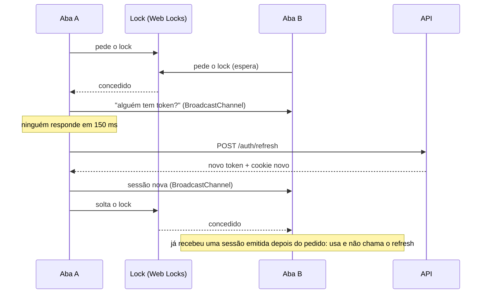

# 9. Frontend

SPA com Vite, React, TypeScript, Tailwind CSS e shadcn/ui, na pasta `frontend/`. As decisões do frontend são a D50 a D76, a D78 a D93 e a D97 a D101 dos [Pontos a revisar](README.md#pontos-a-revisar); a D77 é do backend, sobre o motivo do `409` que a agenda usa. Os testes de ponta a ponta seguem a D102 a D104.

## Estrutura de pastas

```text
frontend/src/
├── api/          # Cliente tipado, erros, mensagens, QueryClient e contrato da API
│   ├── openapi.json   # Exportado do backend (D51), versionado
│   └── schema.d.ts    # Gerado por npm run api:types (D51), versionado
├── app/          # Roteador e provedores (TanStack Query e tooltips)
├── components/
│   ├── ui/       # Componentes do shadcn, instalados com npx shadcn add (D58)
│   ├── layout/   # PublicLayout, PanelLayout, PanelPage (moldura das páginas de configuração), PanelPageState (carregando e erro na mesma moldura, D101), marca e link de pular
│   ├── feedback/ # ErrorMessage, PageLoader, RouteError, OfflineNotice (D99), UnsavedChangesProvider e DiscardChangesDialog (D100)
│   └── marketing/# Seção principal da página inicial (Magic, D58)
├── features/
│   ├── scheduling/          # Compartilhado (D66): negócio, disponibilidade, dia e horário, selo, link, regras do cliente, consultas da equipe (D88) e lista de agendamentos com conflictsOf (D89)
│   ├── booking/             # Agendamento público (UC10 e UC11): passos, formulário e sucesso
│   ├── customer-appointment/# Link do cliente (UC12 a UC14): consulta, cancelamento e remarcação
│   ├── auth/                # Sessão entre abas e telas de conta (UC02 a UC04, D70 a D76)
│   ├── team-agenda/         # Agenda da equipe (UC15 a UC18, D78 a D84)
│   ├── work-schedule/       # Expediente e bloqueios (UC08 e UC09, D85 a D88)
│   ├── services/            # Serviços (UC06, D90)
│   ├── team/                # Equipe: convite, "Também atendo", desativação e serviços de cada um (UC04 e UC07, D91)
│   └── business-settings/   # Negócio: nome, endereço, fuso e regras de reserva (UC05, D92)
├── hooks/        # Hooks compartilhados: use-mobile do sidebar, use-retry-after (D76), use-online (D99) e use-unsaved-changes (D100)
├── lib/          # Funções puras: datas e fusos, nome do fuso em português (D101), esquema de cores, prévia da demo e utilitários
├── pages/        # Páginas por grupo de rotas: public/, account/, panel/ e a 404
└── test/         # Configuração do Vitest e servidor do MSW com os handlers

frontend/e2e/     # Playwright (D102 a D104): run.mjs, support.ts e os testes E2E01 e E2E02
```

Os testes ficam ao lado do código, como `datetime.test.ts`. As páginas ficam agrupadas por grupo de rotas, e não em uma lista plana, porque cada grupo é um módulo carregado sob demanda (D54). `features/` reúne, por funcionalidade, os componentes, as consultas do TanStack Query e os formulários; as páginas apenas os compõem. Uma funcionalidade nunca importa de outra: o que duas usam fica em `scheduling` (D66).

## Rotas (D54)

| Rota | Página | Grupo |
|---|---|---|
| `/` | Apresentação do projeto, com links para a demo e para `/entrar` | Público |
| `/n/:slug` | Página pública do negócio | Público |
| `/agendamento/:token` | Link do cliente | Público |
| `/entrar` | Login | Conta |
| `/esqueci-senha` | Pedido de recuperação de senha | Conta |
| `/convite/:token` | Aceite de convite (link de `app/services/invitations.py`) | Conta |
| `/recuperar-senha/:token` | Nova senha (link de `app/services/passwords.py`) | Conta |
| `/painel` | Agenda | Painel |
| `/painel/servicos`, `/equipe`, `/expediente`, `/bloqueios`, `/negocio` | Configuração | Painel |
| Qualquer outra | Página não encontrada | Principal |

- Todas as rotas são definitivas. As do painel exigem sessão (D73) e respeitam o papel (D74): Serviços, Equipe e Negócio são só do Dono.
- O cadastro de negócio (UC01, `POST /auth/register`) não tem rota no frontend: fica desligado na demo pública (RN27). A sugestão de `/cadastro` está nos [Pontos a revisar](README.md#pontos-a-revisar).
- Cada grupo (público, conta e painel) é um módulo importado com `lazy`, que o Vite separa em um arquivo próprio. O layout público e a 404 ficam no arquivo principal.
- Cada grupo tem um `errorElement` (`RouteError`), então um erro no painel não derruba as páginas públicas. Uma falha ao baixar o módulo, comum logo depois de um deploy, se resolve recarregando a página.
- As páginas abertas por um link com token (`/agendamento`, `/convite` e `/recuperar-senha`) declaram `<meta name="referrer" content="no-referrer">`, para o token não sair no cabeçalho `Referer`.
- `PATHS`, em `src/app/router.tsx`, monta esses caminhos; os testes do roteador os usam.

## Cliente da API (D51 a D53)

### Contrato

O OpenAPI do FastAPI é a referência de campos ([API](07-api.md)). O fluxo, sempre que uma rota mudar:

```bash
# No backend: grava frontend/src/api/openapi.json. Dentro do Docker, a pasta do
# frontend não está montada no container da API, então use a saída padrão:
docker compose exec -T api python -m app.scripts.export_openapi - > frontend/src/api/openapi.json

# No frontend: gera src/api/schema.d.ts
npm run api:types
```

O CI confere os dois arquivos: `export_openapi --check` no job do backend e `api:types` seguido de `git diff --exit-code` no do frontend. A conferência ignora a diferença entre CRLF e LF, por causa do checkout no Windows.

### Endereço

Os caminhos do OpenAPI já começam com `/api/v1`, então a base do cliente é só a origem: `import.meta.env.VITE_API_BASE_URL ?? ''`.

- **Desenvolvimento:** a base é vazia. O Vite repassa `/api` para `VITE_API_PROXY_TARGET` (padrão `http://api:8000`, dentro do Docker; fora dele, `http://localhost:8002`), e frontend e API ficam na mesma origem. O cookie de refresh, com `SameSite=Strict` e `Path=/api/v1/auth`, funciona sem CORS.
- **Produção:** `VITE_API_BASE_URL` é a origem da API, como `https://api.exemplo.com`, definida no build. Frontend e API ficam em subdomínios do mesmo domínio ([Arquitetura](08-arquitetura.md#deploy)), e o cliente envia `credentials: 'include'` para o cookie acompanhar as chamadas de autenticação. A origem do frontend precisa estar em `CORS_ALLOWED_ORIGINS`.

### Erros e repetições

Toda chamada do cliente (`api`, em `src/api/client.ts`) termina de um destes jeitos:

- **Sucesso:** devolve os dados tipados. `unwrap(api.GET(...))` devolve só os dados.
- **`ApiError`:** qualquer resposta fora de 2xx. Traz `status`, `code` (ou `null` quando o corpo não é `problem+json`, como uma página de erro do proxy), `title`, `detail`, `fieldErrors` (cada item com `field`, como `customer.phone`, sem o prefixo `body`), `retryAfterSeconds` no `429` e o corpo completo em `body`, para campos extras como `conflicts`.
- **`NetworkError`:** a requisição não teve resposta. Uma requisição cancelada mantém o `AbortError`, que o TanStack Query ignora.

As mensagens de `fieldErrors` vêm do Pydantic, em inglês; os formulários mostram textos próprios por campo. `ApiErrorCode` é o enum `ErrorCode` gerado (D97): um código novo da API só compila com o seu texto. Para os códigos com corpo próprio, `problemOf(error, code)` devolve o corpo com o tipo do OpenAPI (D94), sem conferência à mão. O texto para o usuário vem de `errorMessage(error)`, em `src/api/messages.ts`, que traduz cada `code` para o português, usa uma mensagem de conexão para `NetworkError`, uma de indisponibilidade para `5xx` sem código e uma genérica para o resto. No `429`, acrescenta quanto tempo esperar. O componente `ErrorMessage` mostra essa mensagem, com um botão opcional de tentar de novo.

O `QueryClient` (`src/api/query-client.ts`) repete uma leitura só depois de `NetworkError` ou `5xx`, no máximo 2 vezes. Um `4xx`, inclusive o `429`, é uma resposta final. Mutações nunca são repetidas, porque podem ter chegado à API, e usam `networkMode: 'always'`: sem rede, falham na hora com a mensagem de conexão, em vez de esperar para sair sozinhas quando a rede volta (D99). As leituras também não são refeitas ao voltar para a aba e ficam válidas por 30 segundos.

### Token no cliente

A sessão se pluga em `setAccessTokenProvider`, que pode devolver uma `Promise`, e em `setUnauthorizedHandler` (D72). O cliente só pede o token para rotas autenticadas: as públicas e as de conta, exceto `/auth/me`, nunca levam `Authorization`. Ele envia `X-Requested-With` apenas em `/auth/refresh` e `/auth/logout`, as rotas com cookie que exigem o cabeçalho contra CSRF. Um `401` numa requisição que levou token causa uma renovação e uma nova tentativa da mesma requisição.

**A renovação de sessão precisa ser única entre abas.** O refresh tem rotação sem tolerância: duas chamadas simultâneas com o mesmo cookie, como ao recarregar duas abas, são tratadas como reuso e encerram a sessão ([Arquitetura](08-arquitetura.md#frontend), UC02). A solução está em [Sessão](#sessão-d70-a-d73).

### Sessão (D70 a D73)

O código fica em `src/features/auth/session`. O token de acesso só existe em memória; o `localStorage` guarda apenas a indicação `agenda-inteligente:tem-sessao` (D71).



- **Ao abrir o site:** `main.tsx` chama `getAppSession().start()` uma vez. Sem a indicação, a sessão é anônima sem nenhuma requisição. Com ela, a aba renova pelo fluxo acima; se outra aba já tem token, recebe-o sem gastar rotação.
- **Renovação:** dentro do lock `agenda-inteligente:refresh`. Antes de chamar `/auth/refresh`, a aba relê o que chegou pelo canal `agenda-inteligente:sessao` enquanto esperava e pergunta às outras se alguém tem token com mais de 1 minuto de validade. Quem renova manda o resultado antes de soltar o lock. Chamadas simultâneas da mesma aba compartilham uma promessa.
- **Quando renova:** quando falta menos de 1 minuto e uma requisição precisa do token (o provedor do cliente é assíncrono), e uma vez depois de um `401` (D72). Não há timer, então uma aba parada não gasta rotações.
- **Login:** avisa as outras abas, que adotam o token; uma aba em `/entrar` segue para o painel. O cache do TanStack Query é limpo, porque o usuário pode ser outro.
- **Saída:** `/auth/logout` dentro do lock; depois, todas as abas limpam a sessão e o cache e vão para `/entrar`. A sessão local termina mesmo se o logout falhar na rede. A redefinição de senha (`204`) também encerra a sessão em todas as abas, porque a API revoga todas.
- **Refresh recusado (`401`):** a sessão termina em todas as abas, e `/entrar` explica que ela terminou. Falha de rede ou `5xx` mantêm a sessão e a indicação.
- **Sem Web Locks** (contexto inseguro, como `http://192.168.x.x`): só as chamadas da mesma aba ficam em série. Em `localhost` e em HTTPS o lock existe.
- **Rotas protegidas (D73):** o loader do grupo do painel espera o `start()` e, sem sessão, leva a `/entrar?voltar=<caminho>`. `?voltar=` só aceita caminhos de `/painel`.
- **Papéis (D74):** o menu do Profissional mostra Agenda, Expediente e Bloqueios; Serviços, Equipe e Negócio são do Dono (`RequireOwner`), e um Profissional que abre uma delas volta para `/painel`. É conforto; a segurança é a do backend.
- **Conferido no Chrome** com duas abas do mesmo perfil: abrir a segunda aba não chama o refresh, e recarregar as duas no mesmo instante produz um único `POST /auth/refresh`, visto no Network e no log da API.

## Identidade visual (D55, D59 a D62)

Agendamento para barbearia, salão e estética: o cliente marca pelo celular, e a equipe usa o painel no balcão, sob luz forte. A direção é **vinho e eucalipto sobre porcelana**: vinho (couro da cadeira de barbeiro, o "marsala" do salão) como cor de ação, eucalipto (spa, toalha verde) como cor de apoio e de sucesso, e neutros de porcelana levemente rosados, sem creme. Os valores ficam em `src/index.css`, que é a referência do design system (D62).

### Cores

Tokens do shadcn em OKLCH, mais os de sucesso (D60). Claro e escuro seguem a preferência do sistema: `src/lib/color-scheme.ts` aplica a classe `dark` em `<html>` e acompanha mudanças, então um botão pode entrar depois sem mudar o CSS.

| Token | Claro | Escuro | Uso |
|---|---|---|---|
| `primary` | `oklch(0.43 0.125 5)` | `oklch(0.79 0.085 5)` | Vinho; no escuro, a versão clara (rosé). Botão principal, links, item ativo |
| `accent` / `accent-foreground` | `0.95 0.022 5` / `0.40 0.115 5` | `0.29 0.05 5` / `0.89 0.05 5` | Hover, item ativo do menu, horário escolhido |
| `success` / `success-foreground` | `0.47 0.075 168` / `0.99 0.004 350` | `0.78 0.09 168` / `0.20 0.035 168` | Eucalipto: só apoio e sucesso, nunca uma segunda cor de ação |
| `success-soft` / `success-soft-foreground` | `0.95 0.025 168` / `0.38 0.065 168` | `0.27 0.04 168` / `0.86 0.07 168` | Selos "Confirmado" e "Concluído" |
| `destructive` | `oklch(0.53 0.155 42)` | `oklch(0.77 0.12 42)` | Vermelhão, de matiz alaranjado, longe do vinho |
| `background` / `foreground` | `0.99 0.004 350` / `0.22 0.025 355` | `0.165 0.012 355` / `0.965 0.005 355` | Porcelana e tinta |
| `muted-foreground` | `0.48 0.022 355` | `0.74 0.018 355` | Texto de apoio |
| `input` | `0.64 0.015 355` | `0.52 0.016 355` | Borda de campo e fundos `bg-input/*`, nunca texto. Opaca: um branco translúcido se mistura em sRGB e fica abaixo de 3:1 |
| `ring` | `0.53 0.14 5` | `0.70 0.12 5` | Anel de foco (D61) |

Contraste medido na página renderizada, com o chrome-devtools:

| Par | Claro | Escuro | Mínimo |
|---|---|---|---|
| `foreground` / `background` | 16.94 | 17.40 | 4.5 |
| `muted-foreground` / `background` | 6.42 | 8.29 | 4.5 |
| `muted-foreground` / `muted` | 5.92 | 6.80 | 4.5 |
| `primary-foreground` / `primary` | 8.45 | 8.96 | 4.5 |
| `primary` / `background` (texto e links) | 8.45 | 9.62 | 4.5 |
| `accent-foreground` / `accent` | 8.44 | 10.19 | 4.5 |
| `destructive` / `background` | 5.48 | 8.98 | 4.5 |
| `destructive` / fundo `destructive/10` | 4.75 | 7.75 | 4.5 |
| `success-foreground` / `success` | 6.39 | 9.30 | 4.5 |
| `success-soft-foreground` / `success-soft` | 8.46 | 9.90 | 4.5 |
| `foreground` / `sidebar` | 16.15 | 16.71 | 4.5 |
| `ring` / `background`, `card` e `muted` | 5.54 / 5.70 / 5.11 | 6.81 / 6.36 / 5.59 | 3 |
| `input` / `background` | 3.28 | 3.47 | 3 |

- **Ação destrutiva:** sempre com ícone e texto, nunca só a cor, e nunca como botão sólido ao lado do principal. A variante `destructive` do botão e do selo usa fundo `/10` nos dois modos, e o hover muda a borda em vez de escurecer o fundo (D58).
- **Gráficos:** `chart-1` a `chart-5` alternam vinho e eucalipto, para quando houver gráficos.

### Tipografia (D59)

- **Geist** (`--font-sans`) no corpo, nos formulários, nos botões e nos horários. Horários e preços usam `tabular-nums`.
- **Bricolage Grotesque** (`--font-heading`) só em títulos: `h1` e `h2`, títulos de card e de sheet, nome do negócio e a marca. Entrou só o eixo de peso (41 KB no latim); o arquivo com tamanho óptico pesava quase o dobro.
- Escala: `h1` das páginas públicas de 2.375rem no celular a 3.25rem no desktop, com altura de linha 1.05; telas de conta e páginas de erro públicas (404, link inválido e negócio não encontrado) de 2rem a 2.375rem; painel, compacto de propósito, de 1.5rem a 1.875rem. `h2` das páginas públicas de 1.75rem a 1.875rem; no painel, todo título de seção tem 1.125rem; `h3` em 1.125rem, Geist 600; corpo em 1rem com altura de linha 1.5; nada abaixo de 0.75rem. Os títulos usam `letter-spacing: -0.015em` e `text-wrap: balance`.
- As duas fontes vêm do `@fontsource`, com versão exata (D50), sem CDN.

### Forma, sombras e movimento (D60)

- **Raio:** `--radius` de 0.625rem: 10 px em botões e campos, 14 px em cards (`rounded-xl`) e pílula nos horários e selos.
- **Sombras:** `shadow-xs` a `shadow-lg` em duas camadas, tingidas com a cor do texto no claro. No escuro, a elevação vem da superfície mais clara, da borda e de um brilho no topo.
- **Movimento:** `--duration-fast` (120 ms, hover e toque), `--duration-base` (200 ms) e `--duration-slow` (300 ms, gavetas), com `ease-enter` (`cubic-bezier(0.2, 0, 0, 1)`) e `ease-exit` (`cubic-bezier(0.4, 0, 1, 1)`). Só CSS e `tw-animate-css`. Com `prefers-reduced-motion: reduce`, animações e transições ficam instantâneas.
- **Navegador:** seleção de texto, cursor de digitação, `accent-color`, barra de rolagem e sublinhado dos links seguem a paleta.

### Foco e acessibilidade (D61)

- **Foco:** todo `:focus-visible` recebe contorno sólido de 2 px em `--ring`, deslocado 2 px. A regra fica fora das camadas do Tailwind, então vence o `outline-none` dos componentes do shadcn; o halo deles continua como enfeite. O deslocamento faz o anel ser medido contra o fundo da página, e não contra o vinho do botão.
- **Diálogos:** o contêiner que o Radix foca ao abrir um diálogo (`role="dialog"` ou `role="alertdialog"`, com `tabindex="-1"`) não recebe o contorno, porque não é um controle.
- **Gaveta do painel:** fecha com Esc, tocando fora ou escolhendo um item, como no shadcn. O Radix só devolve o foco a um `SheetTrigger`, e o Sidebar abre a gaveta com um botão comum; por isso o botão "Menu" retoma o foco ao fechar, assim que o Radix tira o `aria-hidden` do resto da página.
- **Toque:** alvos de pelo menos 44 px nas páginas públicas e no painel abaixo de 768 px (cabeçalho, botão "Menu" com rótulo e itens da gaveta). A partir de 768 px, o menu lateral volta à densidade do shadcn.
- **Marca de sucesso:** círculo `success-soft` com o ícone, de 48 px no fim dos fluxos públicos (a reserva e o link do cliente, com marca, título e texto de apoio) e de 32 px nos avisos do painel, que é compacto (D59).
- **Papéis dos avisos (D101):** `role="alert"` só para erro e recusa; informação, aviso da demo e sucesso usam `role="status"`. O `Alert` do shadcn traz `alert` fixo, então cada aviso informativo passa `role="status"`, e o de dentro de um contêiner `status` passa `role={undefined}`.
- `lang="pt-BR"`, link "Pular para o conteúdo" em cada layout e textos de leitores de tela traduzidos nos componentes do shadcn.

### Layouts e página inicial

- **Público** (`PublicLayout`): pensado para celular a partir de 360 px. O rodapé é o único lugar que cita o projeto de portfólio.
- **Painel** (`PanelLayout`): sidebar do shadcn, com menu lateral a partir de 768 px e gaveta abaixo disso.
- **Marca** (`Brand`): glifo próprio em SVG, com três fichas de horário e a do meio escolhida.
- **Página inicial:** texto para o dono do negócio. A prévia da hero é uma ilustração estática numa moldura de celular, escondida dos leitores de tela; os horários não têm borda, hover nem cursor de clique. A data mostrada é o próximo dia de expediente da demo, a partir de hoje no fuso do negócio (`src/lib/demo-preview.ts`). "Como funciona" mostra três passos, cada um com um recorte da interface em vez de ícone.

## Conta e sessão (UC02 a UC04)

O código fica em `src/features/auth`; as páginas de `src/pages/account` só escolhem a tela, e `src/pages/panel` monta o `PanelLayout` com a conta e o "Sair".

| Arquivo | Conteúdo |
|---|---|
| `session/session.ts` | Gerenciador da sessão, sem React: estado, `start`, `getAccessToken`, `handleUnauthorized`, `login`, `logout` e `end` (D70 a D72) |
| `session/tab-sync.ts` | Lock (Web Locks, com alternativa local) e canal (`BroadcastChannel`, com alternativa muda) |
| `session/session-hint.ts` | A indicação no `localStorage` (D71) |
| `use-session.ts` | `useSession()`, com `useSyncExternalStore` |
| `queries.ts` | `meQuery` (`['auth', 'me']`) e as mutações de login, saída, recuperação, redefinição e convite |
| `schemas.ts` | Esquemas zod com textos em português; a senha nova segue a RN30, contada em caracteres como a API |
| `return-to.ts` | `?voltar=` seguro (D73) |
| `demo.ts` | Contas da demo e `VITE_DEMO_PASSWORD` (D75) |
| `guard.ts` | Loader do painel |
| `use-panel-account.ts` | Usuário, papel e "Sair" para o painel, e a saída quando a sessão termina |
| `components/` | Moldura das telas de conta, campo de senha, login, demonstração, recuperação, nova senha e `RequireOwner` |

### Telas

- **Moldura:** uma coluna estreita, com o título em Bricolage. A partir de 640 px, o formulário fica num card; no celular, direto na página. Campos e botões com 44 px.
- **Senha:** campo do `input-group` do shadcn com o botão "Mostrar"/"Ocultar", com texto visível e 44 px de toque (um `::after` cobre a borda do grupo). Colar e o gerenciador de senhas funcionam (`autocomplete` `current-password` ou `new-password`). O contorno de foco (D61) envolve o grupo inteiro.
- **`/entrar`:** e-mail e senha. Credenciais erradas mostram "E-mail ou senha incorretos." sem dizer qual campo errou, limpam a senha e devolvem o foco a ela. Abaixo, "Conhecer pela demonstração" entra como Dono ou como Profissional (D75). Uma sessão encerrada por expiração ou por redefinição de senha mostra o motivo.
- **`/esqueci-senha`:** a confirmação é a mesma para qualquer e-mail (RN24) e mostra o endereço digitado, a validade de uma hora e o "Usar outro e-mail", que devolve o foco ao campo. Um e-mail `@demo.example.com` recebe o aviso da RN28 sem chamar a API.
- **`/recuperar-senha/:token` e `/convite/:token`:** o mesmo formulário, com a RN30 (de 12 a 128 caracteres, sem regras de composição), contador de caracteres e dica. O token vai no corpo e nunca no `Referer` (`no-referrer`). Sucesso e link inválido (`400 INVALID_TOKEN`, ou `422` no `token`) trocam o formulário por um painel com o foco no título.
- **`429`:** em todas as telas, a mensagem diz quanto esperar, e o botão fica em "Aguarde N s" ou "Aguarde N min" (D76).
- **Painel:** no rodapé do menu e da gaveta, o nome do usuário, o papel e o negócio, o "Sair" e o "Voltar ao site"; no celular, o cabeçalho mostra o nome do negócio.

**Limitação conhecida:** sem `VITE_DEMO_PASSWORD`, o atalho da demonstração some. Uma rota `POST /auth/demo` no backend tiraria a senha do JavaScript público ([Pontos a revisar](README.md#pontos-a-revisar)).

## Agendamento público (UC10 e UC11)

`/n/:slug` mostra o negócio (`GET /public/businesses/{slug}`) e o fluxo de agendamento. O código fica em `src/features/booking`, mais o compartilhado de `src/features/scheduling` (D66); a página (`src/pages/public/BusinessPage.tsx`) só escolhe entre carregando, não encontrado, erro e o fluxo.

| Arquivo | Conteúdo |
|---|---|
| `scheduling/queries.ts` | `businessQuery` e `availabilityQuery`, com as chaves `['public', 'business', slug, ...]` |
| `scheduling/professionals.ts` | Profissionais aptos (RN07) e o valor de "qualquer profissional" |
| `scheduling/components/` | `DateTimePicker`, `DayStrip`, `ChoiceList`, `ContinueButton`, `StatusBadge` e `CopyLinkButton` |
| `scheduling/staff-queries.ts` | `teamKeys` e as consultas da equipe, dos serviços, do expediente e dos bloqueios, usadas pela agenda e por `work-schedule` (D88); `SelectField` também fica em `scheduling/components` |
| `scheduling/customer-rules.ts` | Regras do nome, do e-mail e do telefone do cliente e `toE164` (D63), obrigatórias ou opcionais |
| `queries.ts` | `useCreateBooking` |
| `use-booking-flow.ts` | Estado do fluxo a partir da URL e do histórico (D65) |
| `idempotency.ts` | Chave de idempotência por tentativa (D64) |
| `customer-schema.ts` | Esquema zod dos dados do cliente, com as regras de `scheduling` e os textos para o cliente |
| `components/` | Passos, resumo, tela de sucesso e página de não encontrado |

### Passos

1. **Serviço:** lista de opções com duração e preço. Um serviço ativo sem profissional aparece desabilitado.
2. **Profissional:** "Qualquer profissional" (padrão, sem `professional_id`, RN10) ou um dos aptos ao serviço. Com um só profissional, o passo é pulado e o nome aparece no resumo.
3. **Dia e horário:**
   - **Dias:** uma faixa de hoje até hoje + `max_advance_days`, no fuso do negócio. Cada dia é buscado quando é escolhido.
   - **Horários:** agrupados em manhã, tarde e noite.
   - **Dia vazio:** fechado, lotado ou fora da antecedência, mostra um estado vazio com um botão para o dia seguinte, e o "Continuar" some. No último dia aberto, a mensagem pede um dia anterior.
   - **Um dia por vez:** o botão avança só um dia, de propósito, mesmo que o seguinte também esteja fechado (na demo, domingo leva à segunda). Procurar o próximo dia com horários exigiria buscar vários dias seguidos e gastaria o limite de 120 requisições por minuto da API.
   - **Celular:** o botão "Continuar com HH:MM" fica fixo no rodapé, e os horários têm `scroll-margin` para não ficarem sob ele.
4. **Seus dados:** nome, e-mail e telefone, validados ao sair do campo e no envio. O erro aparece abaixo de cada campo (`aria-describedby`), e o foco vai para o primeiro inválido.
5. **Sucesso:**
   - Mostra serviço, profissional (o atribuído, quando foi "qualquer"), dia e horário no fuso do negócio.
   - O `access_url` aparece num campo só de leitura, com o botão de copiar. Sem a área de transferência, o link fica selecionado para a cópia manual.

Cada passo tem o título com "N de M" ao lado e uma barra de progresso. Ao abrir um passo depois de uma escolha, o foco vai para o título. No desktop, o resumo fica fixo à direita; no celular, acima do passo. O aviso da RN29 aparece quando `is_demo` é verdadeiro (D48).

### Respostas da API

| Resposta | Comportamento |
|---|---|
| `404` no negócio | Página "Não encontramos este negócio", com links para o início e para a demo |
| `409 SLOT_UNAVAILABLE` | Recarrega a disponibilidade, volta para os horários já atualizados e explica que o horário foi reservado. Os dados digitados ficam guardados |
| `409 IDEMPOTENCY_KEY_REUSED` | Mensagem padrão e nova chave na próxima tentativa |
| `422` com `customer.*` | Texto próprio no campo correspondente; as mensagens do Pydantic nunca aparecem |
| `429` | Mensagem com o tempo de espera, e o botão fica em "Aguarde N s" até o `Retry-After` passar |
| Falha de rede | Mensagem de conexão com "Tentar de novo", que reenvia o mesmo corpo com a mesma chave |
| `email_status: "skipped"` | O link aparece com o aviso de que o e-mail não foi enviado e de que ele só está naquela tela (RN26) |
| `email_status: "unchanged"` | Repetição de um agendamento já feito: `access_url` vem nulo, e a tela diz que o link foi para o e-mail (RN13) |

### Idempotência (D64)

Uma tentativa é um corpo exato. `useIdempotencyKey` guarda a chave e o corpo serializado da última tentativa:
- **Mesmo corpo:** reaproveita a chave. Assim, um clique duplo ou um "Tentar de novo" depois de uma falha de rede nunca criam dois agendamentos.
- **Corpo diferente:** gera uma nova chave com `crypto.randomUUID()`. Uma tentativa depois de um `409` ou de um `422` muda o corpo, então nunca cai em `IDEMPOTENCY_KEY_REUSED`.

O envio também fica barrado enquanto a requisição anterior não termina. Quem barra é uma referência marcada no próprio clique, antes de o React redesenhar o botão.

### Estado na URL (D65)

`?servico=<id>&profissional=<id|qualquer>&dia=<AAAA-MM-DD>`.

- **Histórico:** escolher serviço ou profissional cria uma entrada, então o "voltar" do celular volta um passo. Trocar de dia substitui a entrada.
- **Horário:** vai no estado da entrada do histórico (`location.state`) e só vale se a disponibilidade atual ainda o oferece.
- **Dados do cliente:** ficam só na memória, nunca na URL.
- **Parâmetro inválido:** é ignorado, e o fluxo começa no primeiro passo que falta. Vale para serviço inexistente, inativo ou sem profissional, profissional que não atende o serviço e dia inválido ou fora da antecedência.

### Telefone e moeda (D63)

O telefone é convertido para E.164 antes do envio. Sem `+`, o número é brasileiro: DDD e número, com ou sem o 0 ou o 55 na frente, como `(11) 98765-4321` → `+5511987654321`. Com `+`, vale o código do país digitado. Os preços são formatados em reais (`src/lib/format.ts`).

**Limitação conhecida:** a API não tem país nem moeda por negócio. Um negócio de outro país precisaria dos dois campos, para o telefone digitado sem `+` e para os preços.

## Link do cliente (UC12 a UC14)

`/agendamento/:token` lê o link (`GET /public/appointments/{token}`) e, dentro do prazo, cancela ou remarca. O código fica em `src/features/customer-appointment`; a página (`src/pages/public/CustomerAppointmentPage.tsx`) só escolhe entre carregando, link inválido, erro e o agendamento, e declara `no-referrer` em todos esses estados.

| Arquivo | Conteúdo |
|---|---|
| `queries.ts` | `appointmentQuery`, `useCancelAppointment` e `useRescheduleAppointment`. A chave é `['public', 'appointment', token]`; uma mudança grava a resposta nela e invalida a disponibilidade do negócio |
| `reschedule.ts` | Profissional e dia iniciais da remarcação (D68) |
| `outcome.ts` | O aviso depois de uma mudança e as recusas definitivas (D67) |
| `components/` | Página do agendamento, detalhes, diálogo de cancelamento, remarcação e link inválido; o selo da situação vem de `scheduling` |

### Estados (D69)

| Situação | O que aparece |
|---|---|
| Confirmado, dentro do prazo | "Você pode remarcar ou cancelar até {prazo}", com "Remarcar" e "Cancelar agendamento". Com o serviço fora da página pública (`can_reschedule` falso), só o cancelamento, com o motivo |
| Confirmado, fora do prazo | Aviso "O prazo para alterar pelo link terminou", com "fale com {negócio}" e o link para a página pública |
| Cancelado ou concluído | A situação e o link discreto "Fazer novo agendamento em {negócio}" |
| Não compareceu | Só a situação, sem link |
| `404` | "Este link não abre mais o agendamento", igual para link inexistente, trocado ou expirado (D18) |
| Falha de rede ou `5xx` | Mensagem com "Tentar de novo" |

A situação aparece num selo com ícone e texto, nunca só pela cor. O prazo e os horários estão sempre no fuso do negócio (D56), e a data não quebra no meio de "sexta-feira".

**Limitação conhecida:** a API não tem contato do negócio. O link cita só o nome e leva à página pública; mostrar telefone, endereço ou e-mail exigiria esses campos no negócio e na resposta do link.

### Cancelamento (D67)

1. "Cancelar agendamento" abre um `AlertDialog` com serviço, profissional, dia e horário. O foco começa em "Manter agendamento", então um Enter distraído não cancela.
2. Esc ou "Manter agendamento" fecham sem requisição, e o Radix devolve o foco ao botão que abriu. O Tab fica preso dentro do diálogo.
3. Confirmar envia uma vez só, mesmo com clique duplo, e o diálogo não fecha até a resposta.
4. A resposta decide o resto:
   - **Sucesso:** a página mostra "Cancelado" na hora, e o foco vai para o aviso "Agendamento cancelado", porque o botão que abriu o diálogo sumiu.
   - **Rede, `5xx` ou `429`:** a mensagem aparece dentro do diálogo, que continua aberto para tentar de novo; no `429`, o botão fica em "Aguarde N s".
   - **`404`, `CHANGE_DEADLINE_PASSED` ou `INVALID_STATUS_TRANSITION`:** o diálogo fecha, o link é lido de novo, e um aviso explica a recusa.

### Remarcação (D68)

- Abre na própria página, abaixo do "Horário atual", e busca a página pública do negócio nesse momento, para os profissionais e a faixa de dias.
- **Profissional:** com mais de um apto, a escolha começa no atual, se ele ainda atende o serviço; senão, em "Qualquer profissional", enviado como `professional_id: null` (RN10). Trocar de profissional limpa o horário escolhido.
- **Dia:** começa no do agendamento atual, se ainda estiver na faixa de reserva; senão, hoje.
- **Horários:** os da disponibilidade pública, sem filtro. Ela já conta o agendamento como ocupado para o profissional dele, como a remarcação na API, então um horário sobre o atual só aparece com outro profissional.
- **`409 SLOT_UNAVAILABLE`:** recarrega os horários e avisa que o agendamento continua no horário atual.
- **Celular:** só "Remarcar para HH:MM" fica fixo no rodapé; "Manter o horário atual" vem logo abaixo e fecha a remarcação, devolvendo o foco a "Remarcar".
- As escolhas ficam só na memória: a remarcação não muda a URL.

## Agenda da equipe (UC15 a UC18)

`/painel` é a agenda. A página (`src/pages/panel/index.tsx`) lê `GET /auth/me` e passa à agenda o usuário, o papel e o fuso do negócio (D79); o resto fica em `src/features/team-agenda`.

| Arquivo | Conteúdo |
|---|---|
| `queries.ts` | Agenda da semana, equipe, serviços, expediente, bloqueios e as cinco mudanças, sob `['team', ...]` (D78) |
| `period.ts` | Segunda da semana e `from`/`to` em UTC |
| `use-agenda-params.ts` | `?dia=`, `?visao=semana` e `?profissional=` (D81) |
| `viewer.ts` | Profissional próprio, opções do filtro, quem pode receber agendamento (RN07) e colunas do dia |
| `grid-layout.ts` | Faixa de horas da grade, posição pelo minuto local e pistas de blocos sobrepostos |
| `slot-check.ts` | Expediente do dia, tempo ocupado, faixas livres e a conferência do horário antes do envio (D82) |
| `use-slot-context.ts` | Expediente, bloqueios e agenda do profissional escolhido, lidos quando o formulário abre |
| `messages.ts` | Texto de cada `reason` (D83), do campo de hora, do `email_status` e das recusas definitivas |
| `appointment-schema.ts` | Esquema zod do agendamento manual |
| `use-now.ts` | Relógio da linha "agora" e o instante exato em que o resultado abre |
| `use-desktop.ts` e `sheet-layout.ts` | A partir de 1024 px, grade e semana; gaveta à direita ou de baixo |
| `components/` | `TeamAgenda`, barra e filtro, `DayList`, `AppointmentCard`, `TimeGrid`, `AppointmentSheet`, `CancelAppointmentDialog`, `OutcomeActions`, `RescheduleForm`, `AppointmentForm`, `StaffTimeField`, `SelectField`, `NewAppointmentSheet` e `CreatedNotice` |

### Período e consultas (D78)

- **Uma busca por semana do negócio**, de segunda a segunda. Mudar de dia dentro da semana ou trocar de visão não busca de novo; "Hoje" só busca se mudar de semana.
- **Início do dia:** é o primeiro instante do dia no fuso do negócio, e não "00:00". `from` e `to` vão em UTC, sem frações de segundo.
- **Atualização:** toda mudança grava a resposta nas agendas já lidas e invalida `['team', 'agenda']`, também numa recusa, porque ela pode significar que a tela estava velha.

### Celular e desktop (D80)

| | Celular (até 1023 px) | Desktop (a partir de 1024 px) |
|---|---|---|
| Topo | Título, dia e total; filtro do Dono | Título, dia e total; `‹ Hoje ›`, abas Dia e Semana, filtro do Dono e "Novo agendamento" |
| Dia | Faixa da semana com um ponto nos dias com agendamento, e a lista em ordem, com a linha "agora" | Grade de horários: uma coluna por profissional quando o Dono vê todos; uma só com o filtro ou para o Profissional |
| Semana | Não há | Grade de 7 colunas; com todos, cada bloco leva as iniciais do profissional; o cabeçalho de cada dia leva ao dia e conta os cancelados |
| Cancelados | Grupo recolhido "Cancelados (N)" no fim do dia | O mesmo grupo abaixo da grade do dia |
| Ações | Barra do polegar: `‹`, "Hoje", `›` e "Novo", com 44 px, presa ao rodapé | Na barra do topo |
| Detalhes | Gaveta de baixo | Gaveta à direita |

- **Grade:** cada bloco fica no minuto exato do relógio do negócio, porque a equipe agenda fora da grade (RN19). Blocos sobrepostos dividem a largura; o preparo aparece hachurado depois do atendimento (RN03). A faixa vai de 08:00 às 20:00, ampliada para caber todos os blocos. Cabeçalho e horas ficam fixos, e só a grade rola, inclusive para o lado quando as colunas não cabem. Ela abre em "agora" no dia de hoje, ou uma hora antes do primeiro agendamento.
- **Situação:** sempre com ícone e texto. Um confirmado que já começou mostra "Registrar resultado" no cartão e um relógio no bloco. Cada cartão e cada bloco tem o mesmo nome para leitores de tela: "09:00–09:30, Corte, Ana Souza, com Dono Demo, Confirmado, resultado a registrar".
- **Estados:** esqueleto ao carregar, "Nenhum agendamento neste dia" (ou "Só cancelamentos neste dia") com "Novo agendamento", e erro com "Tentar de novo". Sem rede, o TanStack Query pausa a leitura em vez de falhar (o `networkMode` padrão, como no resto do app) e retoma quando a conexão volta, enquanto a faixa "Sem conexão" explica a espera (D99).

### Agendamento manual (D82)

- **Campos:** profissional (fixo para o Profissional), serviço (os ativos que ele atende, com duração e preço), dia e hora nos campos nativos e, em "Cliente", o nome; e-mail e telefone são opcionais.
- **Ajuda à escolha:** abaixo da hora, o expediente do dia e as faixas livres onde cabe o bloco inteiro, com o preparo. Tocar numa faixa preenche a hora com o início dela.
- **Antes de enviar:** horário passado, fora do expediente ou inexistente na mudança de horário aparece no próprio campo, e o foco vai para a hora.
- **Depois de criar:** "Agendamento criado", com o resumo, o aviso do `email_status` e, quando existe, o link do cliente com "Copiar link". "Ver na agenda" leva ao dia do agendamento.

| Resposta | Comportamento |
|---|---|
| `409 SLOT_UNAVAILABLE` | A mensagem do `reason`, junto da hora, com o nome do profissional; os dados digitados ficam (D83) |
| `422` com `customer.*` | Texto próprio no campo, com o foco nele |
| Outro `422` | Mensagem geral, e a equipe e os serviços são lidos de novo (algo mudou, RN07) |
| Rede ou `5xx` | Mensagem com o erro, abaixo do formulário |

### Cancelar, remarcar e resultado (D83, D84)

- **Cancelar:** `AlertDialog` como o da D67, com o foco em "Manter agendamento"; o texto diz se o cliente recebe e-mail. Rede e `5xx` ficam dentro do diálogo; `404` e `INVALID_STATUS_TRANSITION` fecham, releem a agenda e explicam.
- **Remarcar:** na gaveta, com a mesma escolha de dia e hora. O Dono pode trocar o profissional entre os que fazem o serviço; `professional_id` só vai quando muda. No sucesso, a agenda vai para o novo dia.
- **`409` na remarcação:** `changed_meanwhile` relê a agenda, fecha a remarcação e mostra o agendamento atualizado com o aviso; `in_past`, `outside_working_hours`, `blocked` e `appointment_conflict` mostram o motivo e mantêm a escolha aberta.
- **Resultado:** antes do início, "O resultado do atendimento pode ser registrado a partir das 14:00"; no instante do início, sem recarregar, "Concluído" (direto) e "Não compareceu" (com confirmação). Situação final: só o selo e "Situação final: este agendamento não pode mais ser alterado." (RN15).
- **Foco:** a gaveta abre com o foco nela mesma, para um Enter distraído não registrar "Concluído". O aviso depois de cada ação recebe o foco. Ao fechar, o foco volta ao cartão ou bloco que a abriu; se ele sumiu, vai ao mesmo agendamento onde estiver agora ou ao título "Agenda". O Radix só devolve o foco a um `SheetTrigger`, e a agenda abre as gavetas com botões comuns.

### Contraste da agenda

Medido na página renderizada, com o chrome-devtools, compondo os fundos translúcidos:

| Par | Claro | Escuro | Mínimo |
|---|---|---|---|
| Bloco confirmado (`accent-foreground` / `accent`) | 8.44 | 10.19 | 4.5 |
| Bloco concluído (`success-soft-foreground` / `success-soft`) | 8.46 | 9.90 | 4.5 |
| Bloco não compareceu (`muted-foreground` / `muted`) | 5.92 | 6.80 | 4.5 |
| Horas da grade e textos de apoio do cartão (`muted-foreground` / `card`) | 6.61 | 7.73 | 4.5 |
| "Registrar resultado" (`accent-foreground` / `card`) | 9.84 | — | 4.5 |
| Dia de hoje no cabeçalho da semana (`primary` / `card`) | — | 8.98 | 4.5 |
| Linha e pílula "agora", dia escolhido (`primary-foreground` / `primary`) | 8.45 | 8.96 | 4.5 |

"—": o par não estava na tela medida nesse modo. O bloco confirmado no claro não estava na tela medida; o valor é o do mesmo par na tabela de cores.

## Expediente e bloqueios (UC08 e UC09)

`/painel/expediente` e `/painel/bloqueios` são telas de configuração que se usa pouco: precisam ser claras sem treino e confortáveis com uma mão no celular. As páginas (`WorkingHoursPage` e `TimeBlocksPage`, em `src/pages/panel`) leem `GET /auth/me` e passam o usuário, o papel e o fuso à funcionalidade (D87); o resto fica em `src/features/work-schedule`.

| Arquivo | Conteúdo |
|---|---|
| `week-draft.ts` | A semana em edição: leitura e corpo do `PUT`, adicionar, remover, copiar, comparar, resumo do dia e os problemas antes do envio (D85) |
| `block-period.ts` | Início e fim do bloqueio do relógio do negócio para UTC, "Dia inteiro", sobreposição, próximos bloqueios e o texto de cada um (D86) |
| `queries.ts` | Salvar o expediente, criar e remover bloqueio, com as invalidações (D88); `conflictsOf`, que lê o `409` tipado (D97), foi para `scheduling` (D89) |
| `use-schedule-professional.ts` | De quem é a tela: o próprio Profissional ou a escolha do Dono em `?profissional=` (D87) |
| `components/` | `ScheduleShell` (título, fuso, seletor e estados), `WorkingHours`, `WorkingHoursEditor`, `DayEditor`, `TimeBlocks`, `TimeBlockForm` e `RemoveBlockDialog`; a lista de agendamentos (`AppointmentLinks`) vem de `scheduling` (D89) |

### Expediente (D85)

- **Dias:** uma lista com os sete dias, de segunda a domingo. Cada dia mostra o nome, o resumo ("Fechado" ou `09:00–12:00 e 13:00–19:00`, sem quebrar dentro de um intervalo) e os intervalos em campos nativos de hora, com 44 px.
- **Editar:** "Abrir este dia" ou "Adicionar intervalo" põem 09:00–18:00 num dia fechado ou começam uma hora depois do último intervalo, o turno da tarde depois do almoço. A lixeira tira o intervalo e leva o foco ao de cima ou ao botão de adicionar.
- **Copiar:** "Copiar para…" abre na própria linha uma caixa de 44 px para cada outro dia, com o nome curto ("Segunda"). Os intervalos dos dias marcados são substituídos, e um aviso pede para salvar.
- **Antes de enviar:** hora vazia, fim que não é depois do início e intervalo sobreposto aparecem no campo ao sair dele (`aria-describedby`). Ao salvar, um resumo recebe o foco e leva a cada campo. Intervalos encostados, como 12:00 e 12:00, são aceitos, como na API.
- **Salvar:** a barra presa ao rodapé diz se há alterações, e o botão fica desligado sem elas. O `PUT` substitui a semana inteira.
- **Resposta:** sem agendamentos fora, um aviso de sucesso recebe o foco. Com `appointments_outside_hours`, o aviso diz quantos ficaram fora e que eles continuam marcados (RN22). A lista mostra dia, hora, serviço e cliente no fuso do negócio, e cada item leva ao dia na agenda, com o filtro do profissional para o Dono.
- **Trocar de profissional com alterações:** um `AlertDialog` pergunta antes de descartar, com o foco em "Continuar editando". Sair da página, fechar a aba ou usar o "Sair" com alterações também pergunta antes ([Alterações não salvas](#sem-conexão-e-alterações-não-salvas-d99-e-d100)).

### Bloqueios (D86)

- **Formulário:** início (dia e hora), fim (dia e hora) e motivo, de 1 a 500 caracteres, com contador. "Dia inteiro" troca as horas por primeiro e último dia, lado a lado. O dia começa em hoje no fuso do negócio, e o fim acompanha o início.
- **Fuso (RN06):** a conversão usa `localDateTimeToInstant`. Um horário repetido na volta do relógio usa a primeira ocorrência. Um horário que não existe, como 02:30 em 14/03/2027 em Nova York, é recusado no campo com o motivo. Um dia inteiro vai do primeiro instante do dia ao primeiro do dia seguinte e pode ter 23 ou 25 horas.
- **Antes de enviar:** o período, o motivo e a sobreposição com os bloqueios já listados. O foco vai ao primeiro campo com problema.
- **Lista:** só os bloqueios que ainda não terminaram, em ordem, com "Em andamento" no atual. Cada item tem dia, horas ("Dia inteiro" ou `09:00–12:00`), motivo e "Remover".
- **Remover:** `AlertDialog` como o da D67, com o foco em "Manter bloqueio". O envio é único, a falha aparece dentro do diálogo, e um `404` fecha e avisa que o bloqueio já tinha sido removido. Depois, o foco vai para o aviso.

| Resposta | Comportamento |
|---|---|
| `201` | Aviso "Bloqueio criado: …" com o foco, e o bloqueio aparece na lista; as horas e o motivo são limpos |
| `409 APPOINTMENT_CONFLICTS` | "Há N agendamentos nesse período": o bloqueio não foi criado, e a lista mostra cada agendamento com o link para o dia na agenda. O que foi digitado fica |
| `409 TIME_BLOCK_OVERLAP` | Relê os bloqueios e mostra o que atrapalha, com o dia, as horas e o motivo. O que foi digitado fica |
| Rede, `5xx` e o resto | Mensagem do erro acima do botão |

O `409` dessa rota é a união de `AppointmentConflictsProblem` e `TimeBlockOverlapProblem` no OpenAPI (D94), e `conflictsOf` (de `scheduling`, D89) lê a lista já tipada (D97). Conferido com a API real: um dia inteiro sobre a agenda do Dono da demo listou os três agendamentos do dia.

### Papéis e agenda (D87, D88)

- **Papéis:** o Profissional vê só o próprio cadastro, sem seletor. O Dono escolhe no topo, inclusive ele mesmo enquanto atende ("Dono Demo (você)"), e a escolha fica em `?profissional=`.
- **Agenda:** toda mudança, também uma recusa, invalida o expediente e os bloqueios do profissional e `['team', 'agenda']`. Assim, o agendamento manual (D82) lê de novo as faixas livres.

### Contraste do expediente e dos bloqueios

Medido na página renderizada, com o chrome-devtools, compondo os fundos translúcidos:

| Par | Claro | Escuro | Mínimo |
|---|---|---|---|
| Resumo do dia e "até" (`muted-foreground` / `card`) | 6.61 | 7.73 | 4.5 |
| Erro do campo e do resumo (`destructive` sobre o alerta) | 5.64 | 8.39 | 4.5 |
| Descrição do `409` (`destructive` sobre o alerta) | 5.64 | 7.03 | 4.5 |
| Dia marcado na cópia e "Dia inteiro" (`accent-foreground` / `accent`) | — | 10.19 | 4.5 |
| Dia da lista de agendamentos (`muted-foreground` / `card`) | — | 7.17 | 4.5 |
| "Ver na agenda" (`primary` / `card`) | — | 8.33 | 4.5 |
| Borda do campo de hora e do motivo (`input` / `card`) | 3.38 | 3.23 | 3 |
| Borda da caixa de dia (`input` / `background`) | — | 3.47 | 3 |

"—": o par não estava na tela medida nesse modo.

## Configuração do Dono (UC04 a UC07)

`/painel/servicos`, `/painel/equipe` e `/painel/negocio` são só do Dono (`RequireOwner`, D74): um Profissional que abre uma delas pelo endereço volta para `/painel`. São telas de cadastro, usadas de vez em quando: formulários na própria página, sem modal, com campos de 44 px no celular e o erro de cada campo abaixo dele (`aria-describedby`). As páginas de `src/pages/panel` passam a cada funcionalidade o que ela precisa de `GET /auth/me` (D89); a moldura comum é o `PanelPage`, em `src/components/layout`.

| Pasta | Arquivos |
|---|---|
| `services/` | `service-draft.ts` (preço em centavos, limites, corpo e mudanças do `PATCH`), `queries.ts` (criar e editar, com as invalidações da D93) e `components/` (`ServiceCatalog` e `ServiceForm`) |
| `team/` | `situation.ts` (situação de cada um, ordem da lista e conferência do convite), `queries.ts` (convite, cancelamento do convite, "Também atendo", desativação e serviços) e `components/` (`TeamManager`, `InviteForm`, `CancelInvitationDialog`, `DeactivateDialog` e `MemberServices`) |
| `business-settings/` | `durations.ts` (número e unidade), `settings-draft.ts` (limites, RN05 e mudanças do `PATCH`), `timezones.ts` (lista de fusos), `queries.ts` (`GET` e `PATCH /business`) e `components/` (`BusinessSettings` e `BusinessSettingsForm`) |

### Serviços (D90)

- **Lista:** os ativos e, à parte, os inativos ("Inativo", com ícone), cada um com duração, preparo, preço e "Editar" e "Desativar" ou "Reativar". Um serviço ativo que ninguém da equipe faz traz o aviso de que aparece sem horários na página pública (RN07). Sem serviços, um estado vazio leva ao primeiro.
- **Formulário:** "Novo serviço" ou "Editar" abrem o formulário no lugar, com o foco no nome (ou na duração, quando o nome está travado). Abaixo dos campos, quanto cada agendamento ocupa na agenda (duração mais preparo, RN03).
- **Preço:** em reais, convertido em centavos com conta de inteiros. `50`, `49,90`, `1.234,56`, `R$ 50` e `50.50` valem; `12,345` e `-5` são recusados no campo.
- **Antes de enviar:** os limites da API, no campo ao sair dele e no envio, com o foco no primeiro problema. O `PATCH` leva só o que mudou.
- **Desativar e reativar:** sem diálogo, porque a ação se desfaz. O aviso recebe o foco e diz o que acontece com a página pública e com os agendamentos (RN11).
- **Demo (RN28):** um aviso explica as travas; não há "Novo serviço", e o nome fica só de leitura, com o cadeado e o motivo.

| Resposta | Comportamento |
|---|---|
| `201` e `200` | O serviço entra na lista na hora, e um aviso com o foco diz o que fazer em seguida |
| `422` com o campo | O texto próprio do campo, com o foco nele; nunca a mensagem do Pydantic |
| `403 DEMO_RESTRICTED`, rede e `5xx` | A mensagem do erro dentro do formulário, que mantém o que foi digitado |

### Equipe (D91)

- **Lista:** o Dono primeiro, depois ativos e pendentes; os desativados ficam num grupo recolhido, sem ações. Cada linha tem nome, situação (ícone e texto), e-mail e os serviços, com os inativos marcados.
- **Convite:** nome e e-mail, conferidos antes do envio. O sucesso diz para onde foi e até quando vale, no fuso do negócio, e recebe o foco; o pendente entra na lista. Convidar de novo um pendente, pelo formulário ou por "Reenviar convite", renova o link e diz que o anterior deixou de valer (RN24).
- **"Também atendo":** no topo, quando o Dono não tem registro; na linha dele, quando deixou de atender. O aviso leva ao expediente.
- **Desativar:** `AlertDialog` com o foco em "Manter na equipe", o texto de que é definitivo e envio único. Esc devolve o foco ao botão. Para o Dono, "Deixar de atender", com "Continuar atendendo" e sem o texto de definitivo (RN23). Um pendente não tem essa ação, porque prenderia o e-mail: ele tem "Cancelar convite".
- **Validade do convite (D98):** a linha do pendente diz "Entra nas reservas quando aceitar o convite, que expira em quinta-feira, 19/11/2026 às 13:00", no fuso do negócio, ou "O convite venceu em …. Reenvie para mandar um novo link." (D95).
- **Cancelar convite (D98):** fora da demo, ao lado de "Reenviar convite". O `AlertDialog` segue a D67, com o foco em "Manter convite", e diz que o link deixa de valer, que a pessoa sai da equipe com os serviços e o expediente já configurados e que o e-mail fica livre para um novo convite (D96).
- **Serviços de cada um:** "Serviços" abre na linha uma caixa de 44 px por serviço, com o foco na primeira. "Salvar serviços" fica desligado sem mudança; depois de salvar, um aviso recebe o foco, e "Fechar" devolve o foco ao botão.

| Resposta | Comportamento |
|---|---|
| `202` do convite | Aviso com o e-mail e a validade; os campos são limpos |
| `409 EMAIL_IN_USE` | Texto no campo do e-mail, com o foco nele; muda ao editar o e-mail |
| `429` do convite | Mensagem com o tempo de espera, e "Enviar convite" e "Reenviar convite" ficam em "Aguarde N min" (RN26) |
| `409 APPOINTMENT_CONFLICTS` da desativação | O diálogo fecha; o aviso diz quantos agendamentos há pela frente ("Você tem…", para o Dono) e lista cada um com o link para o dia na agenda, filtrado pelo profissional |
| `404` da desativação | O diálogo fecha, a lista é lida de novo, e um aviso explica |
| Rede e `5xx` na desativação | A mensagem dentro do diálogo, que continua aberto para tentar de novo |
| `204` do cancelamento do convite | A linha sai na hora, e o aviso com o foco diz que o link deixou de valer e que o e-mail pode ser convidado de novo |
| `409 INVITATION_NOT_PENDING` | O diálogo fecha, a equipe é relida, e o aviso diz que o convite não está mais pendente (aceito ou conta desativada) |
| `404`, rede e `5xx` no cancelamento | Como na desativação: o `404` fecha e explica; o resto fica dentro do diálogo |

### Negócio (D92)

- **Página pública:** o endereço completo num campo só de leitura, com "Copiar link" (`CopyLinkButton`) e "Abrir a página pública". Mostra o `slug` salvo, e não o que está sendo digitado.
- **Campos:** nome e endereço (com `/n/` na frente); fuso, num `<select>` nativo agrupado por região, com o Brasil primeiro; intervalo entre horários; antecedências e prazo. A antecedência mínima e o prazo usam número e unidade; a máxima, dias.
- **Antes de enviar:** os limites da API e a mínima que não supera a máxima, mostrada na unidade da página ("não pode passar da máxima (30 dias)"). O foco vai ao primeiro problema.
- **Fuso:** o `AlertDialog` explica, antes de salvar, o que muda. Depois, a lista de `appointments_outside_hours` usa o novo fuso e mostra o profissional de cada agendamento.
- **Salvar:** a barra presa ao rodapé, como no expediente. O sucesso recebe o foco.
- **Demo (RN28):** nome e endereço ficam só de leitura, com o cadeado e o motivo; o fuso e as regras de reserva continuam editáveis.

| Resposta | Comportamento |
|---|---|
| `200` sem troca de fuso | "Configurações salvas. Elas valem para as próximas reservas." |
| `200` com `appointments_outside_hours` | Quantos ficaram fora do expediente, que continuam marcados, e a lista com os links para a agenda |
| `409 SLUG_IN_USE` | Texto no campo do endereço, com o foco nele |
| `422` com o campo | O texto próprio do campo (por exemplo, um fuso que a API não conhece) |
| `403`, rede e `5xx` | A mensagem do erro acima da barra, com o que foi digitado |

### O que é invalidado (D93)

Cada mudança grava a resposta no cache e invalida o que depende dela, também numa recusa. Serviços e equipe invalidam a agenda e todas as páginas públicas (`['public', 'business']`). O negócio invalida tudo de `['team']` e as páginas públicas, e a página invalida `['auth', 'me']`, de onde vêm o fuso, o nome e o `slug` da sessão.

### Contraste da configuração

Medido na página renderizada, com o chrome-devtools, compondo os fundos translúcidos:

| Par | Claro | Escuro | Mínimo |
|---|---|---|---|
| Campo travado da demo e `/n/` (`muted-foreground` / `muted`) | 5.92 | 6.80 | 4.5 |
| Motivo da trava, dicas e e-mail na equipe (`muted-foreground` / `card`) | 6.61 | 7.73 | 4.5 |
| Intervalo escolhido (`accent-foreground` / `accent`) | 8.44 | 10.19 | 4.5 |
| Intervalo não escolhido (`foreground` / `background`) | 16.94 | 17.40 | 4.5 |
| Fuso no `<select>` (`foreground` sobre o fundo do campo) | — | 12.24 | 4.5 |
| Texto da barra de salvar (`muted-foreground` / `background`) | 6.42 | 8.29 | 4.5 |
| Selos "Atende" e "Ativo" (`success-soft-foreground` / `success-soft`) | 8.46 | — | 4.5 |
| "Desativar" e "Deixar de atender" (`destructive` / `destructive/10` sobre `card`) | 4.86 | — | 4.5 |

"—": o par não estava na tela medida nesse modo. O par do `<select>` no claro e os selos no escuro são os mesmos tokens da tabela de cores.

## Sem conexão e alterações não salvas (D99 e D100)

### Sem conexão (D99)

- **Faixa:** `OfflineNotice` fica no topo do conteúdo do `PublicLayout` (públicas e conta), do `PanelLayout`, da 404 e do erro de rota. Presa ao topo enquanto se rola, com ícone `WifiOff` e o texto "Sem conexão. O que já carregou continua na tela; o resto volta quando a internet voltar.", em `foreground` sobre `background` invertidos. Fica dentro dos layouts, e não acima deles, porque o menu lateral fixo do painel a cobriria.
- **Leitores de tela:** a região `status` fica sempre na página, então a perda da rede é anunciada; a volta é anunciada só a eles ("Conexão restabelecida."), por alguns segundos.
- **Leituras:** pausam e retomam com a rede (`networkMode` padrão), sem esconder os dados já carregados.
- **Mutações:** `networkMode: 'always'`. Sem rede, falham na hora com a mensagem de conexão e o "Tentar de novo" de cada tela, e nunca saem sozinhas depois: cancelar ou agendar minutos mais tarde, sem a pessoa ver, seria pior que a falha. A reserva pública reaproveita a mesma chave no "Tentar de novo" (D64).
- **Conferido no Chrome**, desligando a rede pelo chrome-devtools: a faixa aparece e some, "Entrar como Dono" sem rede falha na hora com a mensagem de conexão, e ao religar a rede nada é reenviado.

### Alterações não salvas (D100)

- **Registro:** cada formulário do painel chama `useUnsavedChanges(dirty)`. O `UnsavedChangesProvider`, no `PanelLayout`, junta os formulários num registro, porque o roteador aceita um só `useBlocker` por vez e uma página pode ter mais de um formulário.
- **Quando pergunta:** ao ir para outra página do painel ou voltar no histórico para outro caminho, ao fechar ou recarregar a aba (`beforeunload`, com a pergunta do próprio navegador) e antes do "Sair". Mudar só a busca da URL (o dia da agenda, `?profissional=`) não pergunta; a troca de profissional do expediente tem a sua própria pergunta (D85), com o mesmo `DiscardChangesDialog`.
- **Quando não pergunta:** sem alterações, depois de salvar e quando a sessão termina por outra aba ou por um refresh recusado, para o painel nunca ficar preso (D73).
- **Diálogo:** "Sair sem salvar?", com o foco em "Continuar editando" (Enter e Esc mantêm o trabalho) e "Descartar e sair".
- **Fora do mecanismo:** fechar a gaveta da agenda e recolher um formulário na própria página descartam sem perguntar ([Pontos a revisar](README.md#pontos-a-revisar)).

## Datas e fusos (D56)

As funções de `src/lib/datetime.ts` recebem sempre o fuso do negócio e nunca usam o do navegador: quem abre a página em Tóquio vê os horários de um negócio de São Paulo como o negócio os vê.

| Função | Exemplo |
|---|---|
| `formatDate` | `10/11/2026` |
| `formatTime` | `09:00` |
| `formatWeekday` | `terça-feira` |
| `formatDateTime` | `terça-feira, 10/11/2026 às 09:00`, como nos e-mails (D37) |
| `formatTimeRange` | `09:00–09:30`, ou com as datas quando o intervalo passa da meia-noite local |
| `toLocalDate` | `2026-11-10`, o dia local do negócio |
| `formatLocalDate` | `terça-feira, 10/11/2026`, para datas sem hora, como `date` da disponibilidade |
| `formatLocalDayParts` | `{ weekday: 'ter', day: '10', month: 'nov' }`, para a faixa de dias |
| `addLocalDays`, `localDateRange` e `isLocalDate` | Contas e validação de dias do calendário, sem fuso |
| `localHour` | A hora (0 a 23) no fuso do negócio, para agrupar os horários por período |
| `localMinutes` | Minutos desde a meia-noite do relógio do negócio, para a grade da agenda |
| `localWeekday` | De 0 (segunda) a 6 (domingo), como o `weekday` da API |
| `localDateTimeToInstant` | Dia e hora locais digitados pela equipe para o instante, com o horário repetido na primeira ocorrência e o inexistente recusado (RN06) |
| `startOfLocalDay` | O primeiro instante de um dia local, que pode ser 01:00 no dia em que o horário de verão começa |
| `parseLocalTime` e `formatMinutes` | `09:07` ↔ 547 minutos |
| `toUtcInstant` | `2026-11-10T12:07:00Z`, o instante para a API, sem frações |

O fuso aparece pelo nome, nunca pelo nome IANA: `timeZoneName`, em `src/lib/timezone-name.ts`, escreve "São Paulo e Brasília" e os outros fusos do Brasil como os brasileiros escrevem, e "Buenos Aires (Argentina)" para os demais. A lista do Negócio usa a mesma função, com o deslocamento ao lado (D101).

`parseInstant` aceita instantes com deslocamento, das rotas públicas, e em UTC, das de administração, e recusa uma string sem deslocamento, que o `Date` leria no fuso do navegador. `isLocalDate` confere o mês além do dia: antes, `2026-13-01` passava, porque o `Date.UTC` o lia como janeiro do ano seguinte.

## Testes (D57)

```bash
npm run test           # Vitest
npm run test:coverage  # com cobertura; mínimo de 80% em src/lib, src/api e em cada pasta de src/features, inclusive services, team e business-settings
npm run test:e2e       # Playwright com o sistema completo (D102); precisa do Docker
npm run typecheck      # tsc -b, inclusive e2e/ e playwright.config.ts
npm run api:types      # regenera src/api/schema.d.ts
```

- **Ambiente:** jsdom, com o processo em `TZ=Asia/Tokyo` (definido em `vite.config.ts`) e 15 s por teste, porque numa execução fria, como no CI, o primeiro teste de cada arquivo espera a transformação dos módulos do painel carregados sob demanda, para que qualquer uso do fuso do navegador apareça nos testes. O `setup.ts` substitui `matchMedia`, `ResizeObserver`, a captura de ponteiro e o `scrollIntoView`, que o jsdom não tem e o `Select` do Radix usa. Os testes da grade e da semana trocam o `matchMedia` para responder ao `(min-width: 1024px)` e o devolvem ao padrão depois. Os testes do agendamento fixam o relógio num instante em que o dia de São Paulo e o de Tóquio são diferentes, com `vi.useFakeTimers({ toFake: ['Date'] })`.
- **API:** o MSW intercepta as requisições em `http://api.test`, o `VITE_API_BASE_URL` dos testes. Uma requisição sem handler faz o teste falhar. Cada teste troca as respostas com `server.use`. `src/test/msw/auth.ts` simula as rotas de `/auth` com estado (cookie, tokens emitidos e contadores por rota), e `src/test/msw/team-agenda.ts`, as rotas da equipe: a agenda de uma quinta-feira com um concluído, um começado à espera do resultado, dois por vir e um cancelado, a equipe e os serviços por papel, o expediente, a criação, a remarcação, o cancelamento e o resultado (que recusa antes do início), com as requisições e os corpos guardados. `src/test/msw/work-schedule.ts` simula, com estado, o expediente e os bloqueios: o `PUT` com o `appointments_outside_hours` escolhido no teste, os bloqueios compartilhados com a agenda, os dois `409` e o `403` de um Profissional fora do próprio cadastro. `src/test/msw/configuration.ts` simula, com estado, o negócio, o catálogo e a equipe (que começam iguais aos da agenda e vêm antes deles na lista de handlers), o convite, "Também atendo", a desativação e os serviços de cada um, com uma recusa escolhida por rota (`configApi.refuse`) e os corpos guardados; `authApi.demo` faz o `GET /auth/me` responder como o negócio da demo. `src/test/panel.tsx` abre uma página do painel com sessão, pelo roteador real.
- **Sessão:** cada teste começa com uma sessão nova, com lock, canal e indicação em memória. `src/test/session.ts` tem o `memoryBus`, que simula o `BroadcastChannel` entre várias "abas" no mesmo processo, e o `withOpenSession`, que simula um navegador já logado. O `VITE_DEMO_PASSWORD` dos testes é `senha-da-demo-de-teste`.
- **Clique duplo e foco:** os testes de clique duplo conferem só que a requisição sai uma vez. Quando a resposta chega entre os dois cliques, o segundo clique devolve o foco ao botão, como faria uma pessoa, então o foco do aviso é conferido em testes de clique simples.
- **Foco depois de uma resposta da API:** quando um componente move o foco num `useEffect` (título de sucesso, painel de resultado), a renderização vem da resposta do MSW, fora de `act()`, e o efeito pode rodar depois de o `findBy…` encontrar o elemento. O teste espera o foco com `await waitFor(() => expect(el).toHaveFocus())`, nunca com `expect` direto. O teste de clique duplo do agendamento usava `expect` direto e falhava em cerca de 3 de cada 20 execuções; a correção foi no teste, porque no navegador o efeito roda logo depois da pintura. Foco movido dentro de uma ação do `user-event`, que já roda em `act()`, ou de forma síncrona, como `setFocus` do React Hook Form, pode ser conferido direto.
- **Cobertura:** datas e fusos, inclusive o horário de verão de São Paulo de 2018 e 2019 e um fuso sem horário de verão; o cliente da API (dados tipados, `problem+json`, `Retry-After`, rede, cabeçalhos e política de repetição); o componente de erro; o roteador; preços e durações; o agendamento público (negócio e slug inexistente, horários no fuso do negócio, dia sem horários, teclado, parâmetros inválidos, idempotência com clique duplo e falha de rede, `409`, `429`, `422`, limite de e-mail, repetição sem link e tela de sucesso); a sessão e as telas de conta (renovação silenciosa com e sem a indicação, duas e três abas renovando ao mesmo tempo com um único `/auth/refresh`, aba nova sem refresh, login, logout e fim da sessão chegando às outras abas, `401` com nova tentativa, login com sucesso, erro e `429`, demonstração, rota protegida que redireciona e volta, `?voltar=` malicioso, papéis, RN30 em caracteres e `429` nas telas de senha); o link do cliente (os quatro status, prazo vencido, serviço desativado, link inválido, foco do diálogo com Esc, cancelamento com clique duplo, recusas definitivas, `429` e falha de rede, profissional e dia iniciais da remarcação, `409`, limite de e-mail e serviço que saiu da página); e a agenda da equipe (o dia de São Paulo com o processo em Tóquio e uma busca por semana, dias sem nova busca e a semana seguinte, filtro do Dono na URL e id desconhecido, Profissional só com a própria agenda, estado vazio e só com cancelados, erro com nova tentativa, grade por profissional e semana, agendamento manual com sucesso, com link, com checagem de passado e expediente, com `409` pelo `reason` e com `422` no telefone, cancelar com confirmação, Esc e clique duplo, recusa definitiva e falha de rede, remarcar para outro dia, `409` que mantém a escolha e `changed_meanwhile`, resultado antes e depois do início, não compareceu com confirmação, situação final sem ações, foco ao fechar as gavetas, período nas mudanças de horário, pistas da grade e faixas livres); e o expediente e os bloqueios (almoço como dois intervalos, fim antes do início e sobreposição recusados antes do envio, cópia entre dias, `appointments_outside_hours` com os links, invalidação da agenda, troca de profissional com alterações, bloqueio criado no fuso do negócio com o processo em Tóquio, horário inexistente e dia inteiro de 23 horas em Nova York, sobreposição conhecida e `409 TIME_BLOCK_OVERLAP`, `409` com conflitos, remoção com confirmação, Esc, clique duplo, falha e `404`, Dono com seletor e Profissional sem ele); e a configuração do Dono (preço em centavos com conta de inteiros e os formatos aceitos, limites do serviço nas bordas, criar, editar só o que mudou, salvar sem mudança, desativar e reativar com clique duplo, `422` com o campo, travas da demo e `DEMO_RESTRICTED`, serviço sem profissional; situação de cada um e ordem da equipe, convite com sucesso e validade no fuso do negócio, conferência antes do envio, `EMAIL_IN_USE`, `429` que segura também o reenvio, renovação pelo botão e pelo formulário, convite desligado na demo, "Também atendo" com `201` e `200`, desativação com confirmação, Esc, clique duplo, `409` com a lista e os links, falha dentro do diálogo e `404`, "Deixar de atender" e o `409` do Dono, serviços do profissional com os inativos marcados e falha ao salvar; número e unidade, RN05 antes do envio, limites, só o que mudou, `slug` em minúsculas e `SLUG_IN_USE`, `422` do fuso, troca de fuso com aviso, desistência e `appointments_outside_hours` no novo fuso, travas da demo; as invalidações da D93; e o Profissional levado de volta para `/painel` nas três páginas); o acabamento (validade do convite no fuso do negócio, vigente e vencida, com o processo em Tóquio; cancelar convite com confirmação, Esc, clique duplo, invalidações, `INVITATION_NOT_PENDING`, falha dentro do diálogo e `404`; botão ausente na demo; a faixa de sem conexão aparecendo e sumindo no painel e nas páginas públicas, sem tirar os dados da tela; a mutação sem rede que falha na hora e não sai sozinha depois; e a saída sem alterações, com alterações mantidas ou descartadas, depois de salvar, antes do "Sair", o `beforeunload` e o fim da sessão em outra aba, que nunca é barrado).
- **CI:** o job do frontend roda ESLint, `typecheck`, `test:coverage`, a conferência da D51 e o build; o job `e2e` roda `npm run test:e2e` (D104).

### Ponta a ponta (D102 a D104)

```bash
npx playwright install chromium        # uma vez: o Chromium da versão do Playwright do projeto
npm run test:e2e                       # sobe o sistema, roda os testes e desliga tudo
npm run test:e2e -- --headed           # os argumentos vão para o playwright test
npm run test:e2e -- --project=celular  # só um projeto: desktop ou celular
npm run test:e2e -- --keep             # deixa o sistema no ar em http://localhost:5175
npx playwright show-report             # relatório HTML da última execução
npx playwright show-trace test-results/<teste>/trace.zip
```

- **Sistema:** `docker-compose.e2e.yml`, projeto `agenda-e2e`. Portas no host, só em `127.0.0.1`: **5175** (build de produção do frontend, com `vite preview`) e **8003** (API, para depurar). O banco não é publicado. Não conflita com o desenvolvimento (5174, 8002, 5433), com o Mailpit (8025, 1025) nem com o Estoque Inteligente.
- **Ordem:** `run.mjs` remove uma execução anterior, constrói as imagens e sobe o banco, roda `prepare_e2e_database` (recria `agenda_e2e`, aplica as migrações e restaura a demo; recusa qualquer banco sem `_e2e` no fim), sobe a API e o frontend com `--wait` nos healthchecks, roda o Playwright e, no fim, `down -v`. Com falha, grava os logs dos contêineres em `test-results/docker-compose.log`.
- **Testes:** `e2e01-agendar-e-cancelar.spec.ts` e `e2e02-equipe-ve-a-agenda.spec.ts`, nos projetos `desktop` (1280 px) e `celular` (390 px), no Chromium, em `Asia/Tokyo` e `pt-BR`, com um worker só. Os dados vêm da restauração da demo, e os horários são escolhidos pelo que a página mostra (D103).
- **Repetições:** nenhuma localmente. No CI, uma, com `failOnFlakyTests`: o teste que só passa na repetição falha o job. Trace e vídeo de toda tentativa que falha, e captura de tela na falha (D104).
- **Tempo:** cerca de 75 s localmente, com as imagens em cache: uns 35 s para o build de produção e a subida, 8 s para o banco e a demo e 25 s para os 10 testes.

## Uso dos MCPs (D58)

- **shadcn:** consulte os componentes pelo MCP e instale com `npx shadcn add <nome>`. Eles ficam em `src/components/ui` e só mudam para traduzir textos, atender às regras de lint ou alcançar o contraste AA (como a variante `destructive` do botão e do selo). Quando o CLI pede para sobrescrever um componente já ajustado, como o `button.tsx` ao instalar o `alert-dialog`, a resposta é não. O `Slot` do Radix junta as classes sem o `tailwind-merge`, então um tamanho passado a `AlertDialogCancel` precisa do `!`.
- **Magic:** só em componentes de destaque: a seção principal de `/` e a escolha de dia e horário. O resultado é adaptado aos tokens, sem cores fixas e sem dependências fora da D50. A moldura de celular da hero veio do "Great UI Mobile Mockup" (21st.dev, id 23322, MIT), sem o framer-motion. O `DateTimePicker` veio do "Time Slot Picker" (21st.dev, klyv-ui, id 43217), que não tem dependências. Manteve os dois grupos de rádio navegáveis pelo teclado e o fuso sempre impresso. Trocou as datas no fuso do navegador pelas de `src/lib/datetime.ts`, a carga de todos os dias pela de um dia por vez, as cores pelos tokens e os alvos para 44 px, e passou a agrupar os horários por período. O link do cliente reaproveita o mesmo `DateTimePicker` e não tem componente de destaque novo, então não usou o Magic. A grade da agenda (`TimeGrid`) veio do "Event Manager" (21st.dev, vaib215, id 9127), das visões de dia e de semana, que não têm dependências fora da D50. Manteve a coluna de horas e uma coluna por dia. Trocou os blocos presos à célula da hora pelo minuto exato do relógio do negócio, as datas do navegador pelas de `src/lib/datetime.ts`, o arrastar e soltar por um clique que abre a gaveta e as cores fixas pelos tokens; acrescentou as colunas por profissional, as pistas de sobreposição, o preparo hachurado, o cabeçalho e as horas fixos e a linha "agora". O `tabs`, o `select` e o `collapsible` entraram pelo `npx shadcn add`, sem sobrescrever o `button.tsx`. O expediente e os bloqueios também não usaram: o editor da semana é uma lista de campos nativos de hora, sem um componente de destaque, e um componente de agenda semanal com arrastar traria dependência fora da D50 e alvos pequenos no celular. O `checkbox` entrou pelo `npx shadcn add` (o CLI não sobrescreveu nada), e o padrão do exemplo, o rótulo inteiro como alvo de 44 px com o estado marcado na borda e no fundo, foi adaptado aos tokens `primary` e `accent`. A configuração do Dono (serviços, equipe e negócio) também não usou: são telas de cadastro, sem um componente de destaque, e o padrão das outras telas do painel (listas, formulários na própria página e `AlertDialog`) serve melhor que um componente importado. O `native-select` entrou pelo `npx shadcn add`, sem sobrescrever nada, para o fuso (com `optgroup` por região) e as unidades, porque um `<select>` nativo é o mais confortável no celular para uma lista longa; a altura de 44 px vem da página (`[&_select]:h-11`). O `table` chegou a entrar e saiu antes do fim: as linhas de serviço viram formulário na própria lista, o que uma tabela não comporta. As telas de conta também não usaram: são formulários de tarefa, e o único ponto de destaque, o acesso à demonstração, é uma lista de dois botões feita com os componentes existentes. O `input-group` (e o `textarea`, que vem com ele) entrou pelo `npx shadcn add`, e o CLI não sobrescreveu `button.tsx` nem `input.tsx`.
- **chrome-devtools:** cada página nova ou alterada é conferida em 375 px e 1280 px, nos modos claro e escuro, sem rolagem horizontal, sem erros no console, com o contraste dos pares da tabela medido na página e o foco conferido pelo teclado.
- **Skills de design:** na configuração do Dono, a UI/UX Pro Max e a Impeccable foram consultadas antes dos componentes, só para formulários (erro no campo ao sair dele, foco no primeiro problema, retorno visível depois de salvar, ação destrutiva com confirmação). Ficaram de fora o toast e a tabela com TanStack Table, que trariam dependências fora da D50, e qualquer design system gravado em arquivo (D62).
- **Revisão de conjunto (D101):** cada tela alterada foi conferida com o chrome-devtools em 375 px e 1280 px, claro e escuro: títulos, papéis dos avisos, alvos de 44 px, nome do fuso, rolagem lateral e contraste. Ficou registrado, sem correção nesta etapa, que a aba inativa da agenda ("Dia"/"Semana", `text-foreground/60` do `tabs` do shadcn sobre `muted`) mede 4.41 no claro.
- **Acabamento do frontend:** a UI/UX Pro Max e a Impeccable foram consultadas para a faixa de sem conexão, o diálogo de saída e o cancelamento do convite (região `status` atômica, ícone e texto, sem modal para avisar, ação destrutiva confirmada). A busca da UI/UX Pro Max sobre aviso de rede não teve resultado próprio, então valeram as regras gerais de acessibilidade; nenhum arquivo de design system foi gravado (D62). O Magic não foi usado: a faixa é uma linha de texto com ícone, sem componente de destaque. O shadcn não precisou de nada novo (`alert-dialog` e `alert` já existiam). No chrome-devtools, a demo não tem convites e o cadastro está desligado no ambiente local, então o cancelamento foi visto com um script de inicialização que intercepta o `fetch` só na aba (negócio não demo e dois pendentes); o comportamento real fica nos testes com MSW.
- **Arquivos de design system (D62):** nada de `design-system/`, `PRODUCT.md` ou `DESIGN.md` no repositório. A referência é `src/index.css` mais esta seção.
